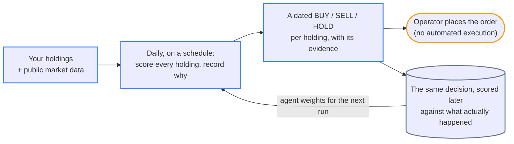

# Nuri-Quant

<div align="center">

[](https://github.com/researcherhojin/nuri-quant/actions/workflows/main-ci-cd.yml)
[](https://codecov.io/gh/researcherhojin/nuri-quant)
[](LICENSE)

**A quantitative decision-support platform that records and scores the evidence behind each investment recommendation.**

</div>

Nuri-Quant reviews a portfolio of US and Korean equities every day. It issues a dated BUY / SELL / HOLD for each holding together with the evidence behind it, then grades each recommendation against what the market actually did.

- **Recommendation only.** The system never places orders; the operator executes every trade by hand.
- **No performance claim.** No investment edge is claimed unless a pre-registered evaluation passes ([`docs/STRATEGY.md`](docs/STRATEGY.md) §3.11).
- **Not investment advice.** The output is a research record for one operator's own decisions.

## How it works



What you get:
- **A decision ledger** — every holding reviewed daily, with the agent verdicts, market context and price levels behind each call.
- **Graded history** — each recommendation scored at 7 to 90 days; agents with better recent hit rates get more weight in the next run.
- **BUY candidates** — stocks outside the portfolio, screened by the rules in [`config/`](config/).
- **A dashboard and briefs** — one Overview page, plus pre- and post-market briefs to Discord.

The universe is US equities and the KOSPI 200. The backend is Python (FastAPI, APScheduler, SQLite) and the dashboard is Next.js. [`docs/ARCHITECTURE.md`](docs/ARCHITECTURE.md) covers the pipeline stages, the schedule and the data sources.

## Quick start

Requirements: Python 3.12+, [uv](https://docs.astral.sh/uv/), TA-Lib and Node.js 22. On macOS: `brew install uv ta-lib fnm && fnm install 22`.
```bash
git clone https://github.com/researcherhojin/nuri-quant.git && cd nuri-quant
cp config/portfolio.example.yaml config/portfolio.yaml  # your holdings (gitignored)
make setup                                              # dependencies, database, git hooks
cd frontend && npm ci && cd ..
cp .env.example .env                                    # API keys, all optional

make start        # API on :8001, dashboard on :3000
make full-scan    # collect data, run the consensus, record decisions
make test-fast    # backend tests
make help         # every target
```

A collector without credentials is skipped or falls back to a keyless source. Leave the Discord and Telegram variables unset on a development machine so that only the production host posts. Full walkthrough: [`docs/FRESH_CLONE_SETUP.md`](docs/FRESH_CLONE_SETUP.md).

## Documentation

| Document | Contents |
|----------|----------|
| [`docs/STRATEGY.md`](docs/STRATEGY.md) | Principles, decisions and investment rules (authoritative) |
| [`docs/ARCHITECTURE.md`](docs/ARCHITECTURE.md) | Pipeline, schedule, data sources, database, CI/CD |
| [`docs/FRESH_CLONE_SETUP.md`](docs/FRESH_CLONE_SETUP.md) | Setup from a fresh clone |
| [`CONTRIBUTING.md`](CONTRIBUTING.md) | Workflow, required checks, pull request rules |
| [`SECURITY.md`](SECURITY.md) | Security policy and LLM data-egress rules |

Every guide is in [`docs/`](docs/), with Korean editions in [`docs/ko/`](docs/ko/).

## Acknowledgements

- The specialist-agent consensus follows [TradingAgents](https://github.com/TauricResearch/TradingAgents), with rule-based agents in place of LLM agents.
- Data freshness policies follow [Dagster](https://docs.dagster.io/guides/observe/asset-freshness-policies).
- Portfolio optimization uses [Riskfolio-Lib](https://riskfolio-lib.readthedocs.io/).
- The investment rules are based on O'Neil (CAN SLIM) and Minervini (SEPA).

## Contributing

Open an issue to agree on scope before submitting a pull request. See [`CONTRIBUTING.md`](CONTRIBUTING.md).

## License

[AGPL-3.0-or-later](LICENSE) · Maintained by [@researcherhojin](https://github.com/researcherhojin)
