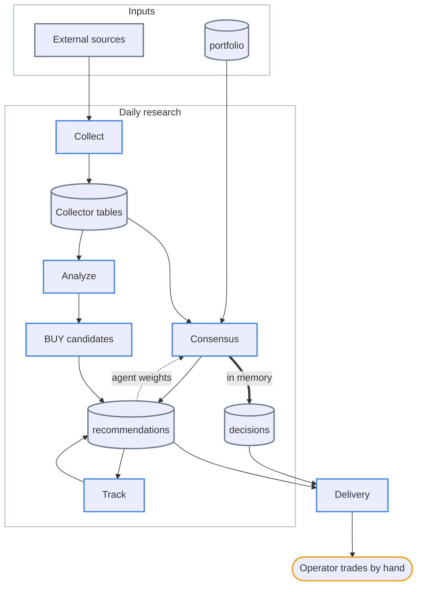

# Nuri-Quant

<div align="center">

[](https://github.com/researcherhojin/nuri-quant/actions/workflows/main-ci-cd.yml)
[](https://codecov.io/gh/researcherhojin/nuri-quant)
[](LICENSE)

**A quantitative decision-support platform that records and scores the evidence behind each investment recommendation.**

</div>

Each day, Nuri-Quant reviews every holding in a portfolio of US and Korean equities. It records a dated BUY, SELL or HOLD recommendation with supporting evidence. It later evaluates each recommendation against market outcomes and uses those results to set each specialist agent's weight in the next review.

> [!IMPORTANT]
> - **Recommendations only.** The system never places an order. The operator places every order manually.
> - **No performance claim.** The project claims no investment edge unless a pre-registered evaluation passes ([`docs/STRATEGY.md`](docs/STRATEGY.md) §3.11).
> - **Not investment advice.** The output is a research record for one operator's own decisions.

## Architecture



Rectangular boxes represent steps, cylinders represent database tables, and the rounded box represents the operator. The two frames group the inputs and the scheduled research jobs for reading; they are not separate hosts or processes. Thin arrows represent external data retrieval, database reads or writes, or delivery to the operator. The operator manually updates `portfolio` after trading; this loop is omitted from the diagram. The thick arrow represents an in-memory data transfer. The dashed arrow shows the only path through which past results influence later recommendations.

This diagram is a subset of the [System Flow](docs/ARCHITECTURE.md#system-flow). A test checks the System Flow's key edges against the code, and another fails if this diagram shows a node or edge that the System Flow lacks.

| Stage | Package | Execution | Writes |
|-------|---------|---------|--------|
| **Collect** | `nuri/collectors` | Collector jobs, with schedules ranging from every 5 minutes during market hours to weekly | `prices`, `signals`, `fundamentals`, `macro`, `news`, … |
| **Analyze** | `nuri/analysis` | The `factors` job | `factors` |
| **Consensus** | `nuri/trading/agents` | The `consensus` job | `recommendations` |
| **Decide** | `nuri/trading/engine` | Inside the consensus job (`record_decisions()`) | `decisions`, `decision_evidence` |
| **Track** | `nuri/trading/recommend` | Outcome and profit-and-loss (P&L) jobs | `recommendations.outcome_*`, `decision_outcomes` |

The diagram highlights three properties:

- **No orchestrator.** `nuri/scheduler.py` registers independent APScheduler cron jobs. Each job reads tables written by other jobs, so the arrows represent data dependencies rather than calls between jobs.
- **One in-memory hand-off.** The thick arrow shows the consensus job passing its result to `record_decisions()` as a Python object rather than through a database table.
- **One learning path.** The dashed arrow shows how results determine agent weights. Each agent's weight is based on its 30-day hit rate. If the 30-day sample is too small, the system uses the 21-day hit rate; if both samples are too small, it uses the agent's default weight. Weights remain within a capped range and are normalized together. This is the only feedback path.

The investment universe covers US equities and the KOSPI 200. The Python backend uses FastAPI, APScheduler and SQLite with write-ahead logging (WAL). The dashboard uses Next.js. Each delivery channel reads a different subset of the data; for example, the Model Context Protocol (MCP) server exposes neither holdings nor decisions. Production runs on a single host managed by launchd. Automatic deployment accepts a commit only after CI passes on `main`. See [`docs/ARCHITECTURE.md`](docs/ARCHITECTURE.md) for the full read/write table, schedule, data sources and deployment details.

## What it produces

| Output | Where |
|--------|-------|
| A dated BUY / SELL / HOLD recommendation for each holding, with supporting agent verdicts, market context and price levels | Dashboard `/decisions` |
| Each recommendation's return at 7, 14, 21, 30, 60 and 90 days | `recommendations`; only the 30-day result, or the provisional 21-day result, affects agent weights |
| BUY candidates outside the portfolio that meet the criteria in [`config/buy_signals.yaml`](config/buy_signals.yaml) | US pre-market brief on Discord |
| Indices, market regime, macroeconomic score, reviews of portfolio holdings, data freshness and pipeline status | Dashboard Overview `/` |
| US and Korean post-market briefs | Discord |
| Candidates, macroeconomic facts, data freshness and live quotes, excluding portfolio holdings | Read-only MCP server (`nuri/mcp`) |

When an input to the dashboard's one-line verdict fails its freshness service-level agreement (SLA), the dashboard replaces the verdict with a notice naming the stale input.

## Quick start

Requirements: Python 3.12+, [uv](https://docs.astral.sh/uv/), TA-Lib and Node.js 22. On macOS: `brew install uv ta-lib fnm && fnm install 22`.

Install:

```bash
git clone https://github.com/researcherhojin/nuri-quant.git && cd nuri-quant
cp config/portfolio.example.yaml config/portfolio.yaml  # your holdings (gitignored)
make setup                                              # dependencies, database, git hooks
cd frontend && npm ci && cd ..
cp .env.example .env                                    # API keys, all optional
```

Run:

```bash
make start        # API on :8001, dashboard on :3000
make full-scan    # collect data, run the consensus, record decisions
make test-fast    # backend tests
make help         # every target
```

- Every API key is optional. A collector without credentials is skipped or falls back to a keyless source.
- Leave the Discord and Telegram environment variables unset on development machines so that only the production host sends messages.
- Full walkthrough: [`docs/FRESH_CLONE_SETUP.md`](docs/FRESH_CLONE_SETUP.md).

## Documentation

| Document | Contents |
|----------|----------|
| [`docs/STRATEGY.md`](docs/STRATEGY.md) | Principles, decisions and investment rules (authoritative) |
| [`docs/ARCHITECTURE.md`](docs/ARCHITECTURE.md) | Pipeline, schedule, data sources, database, deployment, CI/CD |
| [`docs/FRESH_CLONE_SETUP.md`](docs/FRESH_CLONE_SETUP.md) | Setup from a fresh clone |
| [`CONTRIBUTING.md`](CONTRIBUTING.md) | Workflow, required checks, pull request rules |
| [`SECURITY.md`](SECURITY.md) | Security policy and rules governing data sent to large language models (LLMs) |

Every guide is in [`docs/`](docs/), with Korean editions in [`docs/ko/`](docs/ko/).

## Acknowledgements

- The consensus approach follows [TradingAgents](https://github.com/TauricResearch/TradingAgents), using rule-based specialist agents in place of LLM agents.
- Data freshness policies follow [Dagster](https://docs.dagster.io/guides/observe/asset-freshness-policies).
- Portfolio optimization uses [Riskfolio-Lib](https://riskfolio-lib.readthedocs.io/).
- The investment rules are based on O'Neil (CAN SLIM) and Minervini (SEPA).

## Contributing

Open an issue to agree on scope before submitting a pull request. See [`CONTRIBUTING.md`](CONTRIBUTING.md).

## License

[AGPL-3.0-or-later](LICENSE) · Maintained by [@researcherhojin](https://github.com/researcherhojin)
