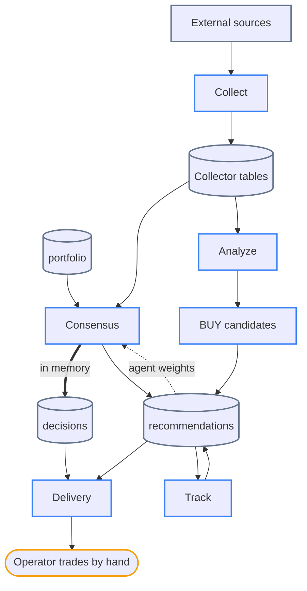

# Nuri-Quant

<div align="center">

[](https://github.com/researcherhojin/nuri-quant/actions/workflows/main-ci-cd.yml)
[](https://codecov.io/gh/researcherhojin/nuri-quant)
[](LICENSE)

**A quantitative decision-support platform that records and scores the evidence behind each investment recommendation.**

</div>

Every day, Nuri-Quant reviews each holding in a portfolio of US and Korean equities and records a dated BUY, SELL or HOLD with the evidence behind it. Later, it grades each recommendation against what the market actually did, and those grades set how much each agent counts in the next review.

> [!IMPORTANT]
> - **Recommendation only.** The system never places an order. The operator executes every trade by hand.
> - **No performance claim.** No investment edge is claimed unless a pre-registered evaluation passes ([`docs/STRATEGY.md`](docs/STRATEGY.md) §3.11).
> - **Not investment advice.** The output is a research record for one operator's own decisions.

## Architecture



Boxes are steps, cylinders are database tables and the rounded box is a person. A thin arrow is a fetch from an external source, a read or a write through the database, or delivery to the operator. The operator's trades change `portfolio` by hand, a loop the diagram leaves out. The thick arrow passes data in memory, and the dashed arrow is the only path by which past results change later recommendations. Every node and arrow comes from the System Flow in [`docs/ARCHITECTURE.md`](docs/ARCHITECTURE.md#system-flow), whose edges a test ties to the code; `tests/verify/test_readme_structure.py` fails if this diagram draws one that the System Flow lacks.

| Stage | Package | Runs as | Writes |
|-------|---------|---------|--------|
| **Collect** | `nuri/collectors` | Collector jobs, from every 5 minutes in market hours to weekly | `prices`, `signals`, `fundamentals`, `macro`, `news`, … |
| **Analyze** | `nuri/analysis` | The `factors` job | `factors` |
| **Consensus** | `nuri/trading/agents` | The `consensus` job | `recommendations` |
| **Decide** | `nuri/trading/engine` | Inside the consensus job (`record_decisions()`) | `decisions`, `decision_evidence` |
| **Track** | `nuri/trading/recommend` | Outcome and P&L jobs | `recommendations.outcome_*`, `decision_outcomes` |

Three properties the diagram encodes:

- **No orchestrator.** `nuri/scheduler.py` registers independent APScheduler cron jobs. Each job reads tables that other jobs wrote, so an arrow is a data dependency, not a call.
- **One in-memory hand-off.** The thick arrow: the consensus job passes its result to `record_decisions()` as a Python object, not through a table.
- **One learning path.** The dashed arrow: each agent's weight comes from its 30-day hit rate, from its 21-day rate while 30-day samples are too few, and is its default weight while both are. Weights stay within a capped range and are normalized together. Nothing else feeds back.

The universe is US equities and the KOSPI 200. The backend is Python (FastAPI, APScheduler, SQLite in WAL mode) and the dashboard is Next.js. Delivery channels read different subsets: the MCP server, for one, exposes neither holdings nor decisions. Production runs on one host under launchd, and its automatic deploy takes a commit only after main CI passes. [`docs/ARCHITECTURE.md`](docs/ARCHITECTURE.md) has the full read/write table, the schedule, the data sources and the deployment.

## What it produces

| Output | Where |
|--------|-------|
| A dated BUY / SELL / HOLD per holding, with the agent verdicts, market context and price levels behind it | Dashboard `/decisions` |
| Each recommendation's return at 7, 14, 21, 30, 60 and 90 days | `recommendations`; only the 30-day result (21-day while provisional) feeds the agent weights |
| BUY candidates outside the portfolio, gated by [`config/buy_signals.yaml`](config/buy_signals.yaml) | US pre-market brief on Discord |
| Indices, regime, macro score, holding reviews, data freshness and pipeline status | Dashboard Overview `/` |
| US and Korean post-market briefs | Discord |
| Candidates, macro facts, freshness and live quotes, without holdings | Read-only MCP server (`nuri/mcp`) |

When an input of the dashboard verdict fails its freshness SLA, the verdict is replaced by a notice naming the stale input.

## Quick start

Requirements: Python 3.12+, [uv](https://docs.astral.sh/uv/), TA-Lib and Node.js 22. On macOS: `brew install uv ta-lib fnm && fnm install 22`.

Install:

```bash
git clone https://github.com/researcherhojin/nuri-quant.git && cd nuri-quant
cp config/portfolio.example.yaml config/portfolio.yaml  # your holdings (gitignored)
make setup                                              # dependencies, database, git hooks
cd frontend && npm ci && cd ..
cp .env.example .env                                    # API keys, all optional
```

Run:

```bash
make start        # API on :8001, dashboard on :3000
make full-scan    # collect data, run the consensus, record decisions
make test-fast    # backend tests
make help         # every target
```

- Every API key is optional. A collector without credentials is skipped or falls back to a keyless source.
- Leave the Discord and Telegram variables unset on a development machine, so that only the production host posts.
- Full walkthrough: [`docs/FRESH_CLONE_SETUP.md`](docs/FRESH_CLONE_SETUP.md).

## Documentation

| Document | Contents |
|----------|----------|
| [`docs/STRATEGY.md`](docs/STRATEGY.md) | Principles, decisions and investment rules (authoritative) |
| [`docs/ARCHITECTURE.md`](docs/ARCHITECTURE.md) | Pipeline, schedule, data sources, database, deployment, CI/CD |
| [`docs/FRESH_CLONE_SETUP.md`](docs/FRESH_CLONE_SETUP.md) | Setup from a fresh clone |
| [`CONTRIBUTING.md`](CONTRIBUTING.md) | Workflow, required checks, pull request rules |
| [`SECURITY.md`](SECURITY.md) | Security policy and LLM data-egress rules |

Every guide is in [`docs/`](docs/), with Korean editions in [`docs/ko/`](docs/ko/).

## Acknowledgements

- The specialist-agent consensus follows [TradingAgents](https://github.com/TauricResearch/TradingAgents), with rule-based agents in place of LLM agents.
- Data freshness policies follow [Dagster](https://docs.dagster.io/guides/observe/asset-freshness-policies).
- Portfolio optimization uses [Riskfolio-Lib](https://riskfolio-lib.readthedocs.io/).
- The investment rules are based on O'Neil (CAN SLIM) and Minervini (SEPA).

## Contributing

Open an issue to agree on scope before submitting a pull request. See [`CONTRIBUTING.md`](CONTRIBUTING.md).

## License

[AGPL-3.0-or-later](LICENSE) · Maintained by [@researcherhojin](https://github.com/researcherhojin)
