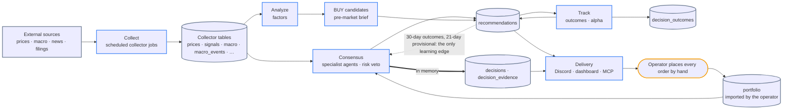
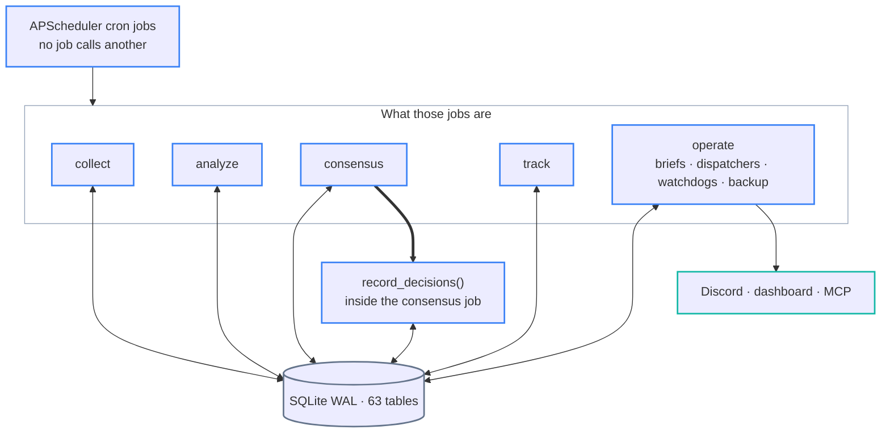
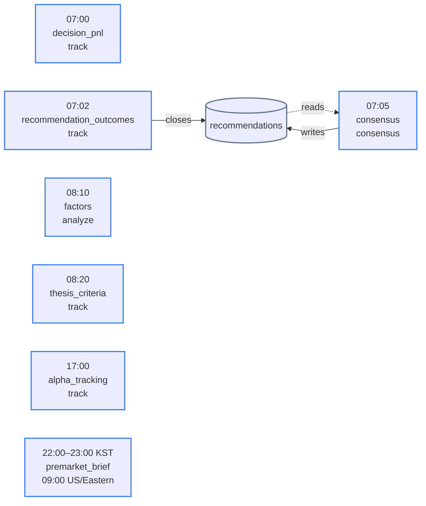
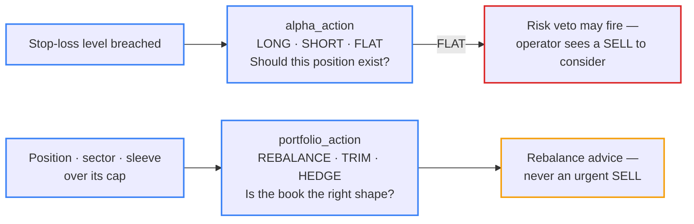

# Architecture Reference

*Korean edition: [ko/ARCHITECTURE.md](ko/ARCHITECTURE.md)*

Detailed reference for Nuri-Quant internals: how data moves through the system, what runs when, and where each piece lives. Statements here are checked against the code; `make verify-doc-counts` checks the counts stated here against the code (its site list is in `scripts/verify/verify_doc_counts.sh`), and [Verifying Numeric Claims](#verifying-numeric-claims) gives the commands that measure them. This file is not auto-loaded; read it when working on cross-cutting concerns.

## System Flow

The system turns public market data and the operator's holdings into a dated BUY / SELL / HOLD per holding, grades each recommendation against what the market then did, and feeds those grades back into the next day's agent weights. It never places an order.



The diagram shows the main path. The table lists each step's inputs and outputs; bookkeeping writes (`collector_runs` and the lifecycle events in `pipeline_events`) are left out.

| # | Step | Runs as | Reads | Writes |
|---|------|---------|-------|--------|
| 1 | **Collect** | Collector jobs, from every 5 minutes during market hours to weekly ([Daily Schedule](#daily-schedule)) | External APIs; `portfolio` for the held tickers; `prices` (for `technical`); the previous `ark` holdings | `prices`, `signals`, `fundamentals`, `macro`, `macro_events`, `news`, `events`, `analyst_ratings`, `earnings_surprises`, `insider_trades`, `superinvestors`, `estimates`, `ark`, `ark_source_dates`, `etf_flows`, `institutional_flows` |
| 2 | **Analyze** | The `factors` job | `prices`, `signals`, `fundamentals`, `macro` (Fear & Greed) | `factors` |
| 3 | **Consensus** | The `consensus` job | Every ticker in `portfolio`; collector tables; `recommendations` outcomes for the agent weights | `recommendations` (`source` NULL) |
| 4 | **Decide** | Inside the consensus job: `record_decisions()` receives the results in memory | The consensus results; `pipeline_events` (a recorded regime change, if any); `macro`, `macro_events`, `prices`, `fundamentals`, `estimates` and `portfolio` through the regime, macro-score and price-target helpers | `decisions`, `decision_evidence` |
| 5 | **BUY candidates** | The `premarket_brief` job | The latest `factors` snapshot, `prices`, `signals`, `portfolio` (holdings are excluded), `pipeline_events` (the re-emit cooldown), `theses` (labels), VIX and the regime inputs | `recommendations` (`source='buy_candidate_emitter'`), `candidate_runs`, `candidate_ledger` |
| 6 | **Deliver** | Brief jobs, outbox dispatchers, the API, the MCP server | `recommendations`, `decisions`, `macro`, `candidate_runs` and more | Discord messages, `discord_outbox`, `market_postmortem` |
| 7 | **Track** | `decision_pnl`, `recommendation_outcomes`, `thesis_criteria`, `alpha_tracking`; `alpha_report` (an operate job that seals the ledger) | `recommendations`, `decisions`, `agent_decisions`, `prices`, `portfolio`, `theses`, `thesis_criteria`, `thesis_criteria_checks`, `signals`, `factors`, `fundamentals` | `recommendations.outcome_{7,14,21,30,60,90}d`, `decisions.pnl_*`, `agent_decisions`, `decision_outcomes`, `thesis_criteria_checks`, `theses.verdict`, `recommendation_seals` |
| 8 | **Learn** | The next consensus run | `recommendations.outcome_30d` (provisional `outcome_21d`) with `agent_verdicts` | The agent weights for that run, recomputed each time and kept in the `scoring_detail` of `recommendations` and `decisions` |

**Collect.** Collectors read external APIs on their own schedules and write one table each (some write several). The `technical` collector computes TA-Lib indicators from `prices`. The operator imports holdings from `config/portfolio.yaml` (`scripts/ops/import_portfolio.py`, run by `make setup` or by hand) or edits them through the portfolio API; database triggers log every insert and delete, and every update that changes a quantity, account or ticker, to `portfolio_changes`.

**Analyze.** The daily `factors` job computes the factor composite (see [Scoring Model](#scoring-model)) for every ticker with at least 14 closing prices. Its readers include the BUY-candidate emitter, the held-add shadow check, the thesis criteria and the rebalance advisor. No consensus agent reads `factors`, and the job runs after the consensus job. No scheduled job maintains a regime or macro-score table: each consumer computes them when it needs them (see [Regime Classifier](#regime-classifier-6-base--4-special)), and the decision record and the candidate runs keep the values they used.

**Consensus and the decision record.** The consensus job runs the specialist agents for every ticker in `portfolio`, weights their verdicts, applies the risk veto and the divergence penalty (see [Scoring Model](#scoring-model)), and writes one `recommendations` row per ticker per day. It then hands the same results to `record_decisions()` as Python objects; that function adds the market context and price levels and writes `decisions` and `decision_evidence`. It applies no gate.

**BUY candidates.** Candidates outside the portfolio come from a different job: the pre-market brief, scheduled in `US/Eastern`, scores the latest `factors` snapshot under the gates in `config/buy_signals.yaml` and `config/rules.yaml` (`vix_gate`), writes the emitted candidates to `recommendations` with `source='buy_candidate_emitter'`, records the run in `candidate_runs` and `candidate_ledger` (one `candidate_runs` row per day, also when the run is blocked), and posts the brief to Discord.

**Deliver.** The pre-market brief, the daily report and the holdings monitor post straight to the `DISCORD_WEBHOOK_URL` webhook. The post-market briefs, the monthly alpha report and collector-failure alerts are staged in `discord_outbox` and posted by the channel dispatcher jobs to per-channel webhooks. The dashboard reads the API (see [Dashboard API](#dashboard-api-projection-based-5s)); AI clients read the MCP server (see [MCP Integration](#mcp-integration)).

**Track.** Outcome jobs grade what was recommended:

- `recommendation_outcomes` fills `recommendations.outcome_{7,14,21,30,60,90}d` with raw returns for every row with an entry price, and sets the hit flags from the 30-day outcome.
- `decision_pnl` fills `decisions.pnl_{7,30,60,90}d` and sets `decisions.outcome` at 90 days.
- `alpha_tracking` mirrors BUY and SELL recommendations into `agent_decisions` (`decision_id = 'rec_{id}'`) and writes `decision_outcomes`: the 7-, 14- and 30-day return against a benchmark where the asset class has one (`measurement_mode.benchmark_by_asset_class` in `config/rules.yaml`), and the alpha.
- `alpha_report` runs daily on every host and records a run event; only where `NURI_ROLE=production` does it seal closed recommendation days into the `recommendation_seals` hash chain and stage the monthly [`docs/STRATEGY.md`](STRATEGY.md) §3.11 progress report.

**Learn.** There is exactly one feedback edge. When the consensus job computes agent weights, learning memory (`nuri/trading/agents/consensus/learning_memory.py`) reads recommendations that carry `agent_verdicts` and a 30-day outcome within the look-back window, falls back to the provisional 21-day outcome, and moves each agent's default weight within a capped range by its hit rate (`config/agents.yaml` `consensus.learning_memory`). `decision_outcomes`, `decisions.pnl_*` and `strategy_memory` do not feed the weights.

**Operate.** The operator executes every trade by hand ([`docs/STRATEGY.md`](STRATEGY.md) §7.1). No other module imports `nuri/trading/execution/`; its brokers are reachable only through that package's own smoke-test command (`python -m nuri.trading.execution.broker`, dry run by default). The `trades` table is written through `POST` / `PUT /api/trades` and the `make trade-log` command.

### Where an LLM is involved

Verdicts are rule-based: the agents, the consensus and the decision record call no LLM. One input and three side features can involve one, always through the logged gateway `nuri/llm/openai_client.py` or a local model:

- **Macro headline classification.** The `macro_news` collector classifies headlines with an external model when `OPENAI_API_KEY` is set (regex fallback; `NURI_DISABLE_EXTERNAL_LLM=1` turns it off) and writes the result to `macro_events`. Those categories reach the Korean-market agent, the event component of the macro score, and the special-regime check.
- **Ticker research briefings** ([`docs/RESEARCH_BRIEFING.md`](RESEARCH_BRIEFING.md)), the optional **portfolio report** on a local Ollama model, and the post-market brief's optional local-model **lessons** from similar past sessions do not feed the recommendation pipeline.

### Manual research path

`make validate`, `make regime`, `make strategy` and `make full-scan` are the research entry points: the signal backtest (`make validate`) writes `signal_results.csv` and `signal_scorecard.csv` to `data/reports/YYYY-MM-DD/`; the strategy map (`make regime`) labels each backtest trade with its entry regime; the strategy monitor (`make strategy`) records `regime_transitions`; and `candidates.py` calibrates confidence from those regime statistics. `make full-scan` runs the backtest, the strategy map and the candidate screen in one pass. No scheduled job runs the backtest. The weekly `memory_snapshot` job reads the newest `signal_results.csv`, with the same signal-by-regime analysis, into `strategy_memory`, so its input is only as recent as the last manual run.

## Runtime Topology

At runtime there is no orchestrator: `nuri/scheduler.py` registers independent APScheduler jobs, and each job reads its inputs from tables written by earlier jobs.



Every job reads its inputs from the database and writes its results back. The thick arrow marks the one in-memory hand-off: the consensus job passes its result to `record_decisions()` as a Python object rather than through a table. Operate jobs write too: the pre-market brief writes BUY candidates, the alpha report writes ledger seals, and the dispatchers update the outbox.

`decide` (named `certify` until #1619) has no job of its own: `record_decisions()` runs inside the consensus job. The portfolio-wide certifier that used to live in this stage is gone — the brief, the dashboard health and violations endpoints and `/api/certify` were detached and the engine module deleted; dashboard violations come from `rebalance_advisor.detect_violations()` (prudential constraints only, execution fields stripped). The `certifications` table stays as a historical ledger.

| Stage | Scheduled as | Reads | Writes |
|-------|--------------|-------|--------|
| **Collect** | Collector jobs, from every 5 minutes during market hours to weekly | External APIs; `prices` (technical indicators) | The collector tables listed in [System Flow](#system-flow) |
| **Analyze** | 1 job: `factors` at `10 8 * * *` | `prices`, `signals`, `fundamentals`, `macro` | `factors` |
| **Consensus** | 1 job: `consensus` at `5 7 * * *` | `portfolio`, collector tables, `recommendations.outcome_30d` / `outcome_21d` (for weights) | `recommendations` with `agent_verdicts` |
| **Decide** | No dedicated job; `record_decisions()` runs inside the consensus job (see above) | Consensus result, handed over in memory; the market-context tables listed in [System Flow](#system-flow) | `decisions`, `decision_evidence` |
| **Track** | `decision_pnl`, `recommendation_outcomes`, `thesis_criteria`, `alpha_tracking` | `recommendations`, `decisions`, `agent_decisions`, `prices`, `portfolio`, `theses`, `thesis_criteria`, `thesis_criteria_checks`, `signals`, `factors`, `fundamentals` | `recommendations.outcome_{7,14,21,30,60,90}d`, `decisions`, `agent_decisions`, `decision_outcomes`, `thesis_criteria_checks`, `theses.verdict` |

The stage directories are `nuri/collectors`, `nuri/analysis`, `nuri/trading/agents`, `nuri/trading/engine` and `nuri/trading/recommend`. Imports that cross these boundaries are allowed only inside function bodies, never at module level, and each one must be listed in an allowlist with a stated reason. `tests/core/test_cross_stage_imports.py` enforces this in both directions.

### Daily Schedule

The stage names describe data dependencies, not execution order. Because nothing chains the jobs, the schedule runs them in a different order:



Outcome tracking is scheduled at 07:02, before the consensus job at 07:05, so the agent weights can include the outcome windows that closed by that morning. Nothing waits for it to finish, and a window whose closing price is not yet collected stays empty until a later run. `factors` runs after consensus, which is harmless because no agent reads it; its readers (thesis criteria at 08:20, the held-add shadow check at 08:30, the pre-market brief in the evening) all run later. `premarket_brief` is scheduled in `US/Eastern`, which places it at 22:00 KST under EDT and 23:00 KST under EST.

Times are host-local; the production host runs on KST. Weekday crons do not consult a holiday calendar, so they also fire on exchange holidays. US-session jobs that fall after midnight KST (the price polls and refreshes, `technical`, `ark` and the US post-market brief) run Tuesday to Saturday KST; the weekly batch (fundamentals, 13F filings, estimates, analyst ratings, ETF flows and the price backfills) runs on Sunday. Any stage job can be re-run on its own, because it reads its inputs from the database or an external API. The decision record is the exception: it receives its input in memory, so it is re-created only by re-running consensus (`make consensus`).

### Processes and Deployment

Production runs on one host under launchd (`scripts/launchd/`): LaunchAgents for the scheduler, the API, the dashboard (`npm run start`), the Discord bot, the autopull receiver, the state replicator, the heartbeat watchdog and the SRE scan, plus a system LaunchDaemon (`system/com.nuri-quant.machine-alive.plist`) that reports the machine itself. The `health-check` plist stays in the directory but is not installed: its schema, table and writer-role checks run as SRE detectors (#939, #952), and `scripts/ops/health_check.sh` runs on demand from the Discord `/health` command.

- **Autopull** (`scripts/deploy/autopull_receiver.sh`, every 5 minutes) fast-forwards to `origin/main` and refuses a dirty tree or a non-fast-forward. It deploys a new commit only after main CI for that commit has succeeded (the push run, or the run `main-ci-catchup.yml` dispatches for a merge made with `GITHUB_TOKEN`, #1812); while the run is missing, in progress or red, or the API cannot be read, it holds and checks again next cycle (#1808). When `pyproject.toml` or `uv.lock` changes it runs `uv sync`; when Python code under `nuri/` or the dependencies change it restarts the scheduler, the API and the Discord bot. After a successful fetch, each cycle also rebuilds and restarts the dashboard when the last `frontend/` commit is newer than the current build (`scripts/deploy/build_frontend.sh`, #1462); a commit whose build failed is not retried until a new `frontend/` commit or `--retry`. Pending migrations are applied by `init_db()` when the restarted scheduler starts; autopull itself only logs a reminder. A commit that changes only `config/` restarts nothing; `rules.yaml` and `agents.yaml` are read at import, so each process picks them up at its next restart (the scheduler restarts itself daily at 08:40).
- **Replicas** (`scripts/deploy/state_replicator.sh`, hourly) copy a `VACUUM INTO` snapshot to the development host's `data/replicas/`, which the MCP server reads.
- **Heartbeats.** On the host, the scheduler writes a heartbeat file every minute; the watchdog alerts and restarts the scheduler when the file is older than 30 minutes, and alerts on a stale backup and on dead API and dashboard ports. Off the host, the scheduler (`NURI_ROLE=production` only) and the machine LaunchDaemon each force-push an empty commit to their own ref (`refs/nuri/heartbeat-mini`, `refs/nuri/machine-mini`) every 10 minutes. `heartbeat-watch.yml` posts to `#ops` when the scheduler's ref is older than 45 minutes, and uses the machine ref's age to tell a silent scheduler apart from a machine that is down. It only checks when GitHub starts its schedule, which can be hours apart, so a dead host can go unreported for hours; that latency is accepted (#1848).

## Decision Axes

Rules that respond to a broken investment thesis are kept separate from rules that respond to position sizing (`nuri/core/axis.py`).

| Axis | Values | Triggered by |
|------|--------|--------------|
| **alpha** | `LONG` / `SHORT` / `FLAT` | A change in the thesis. A stop-loss breach is the only mechanical path to `FLAT`. |
| **portfolio** | `REBALANCE` / `TRIM` / `HEDGE` | Sizing. Concentration, sector-cap and experiment-sleeve breaches are resolved here and never produce an urgent SELL. |



The risk veto reads `alpha_action` (it falls back to a SELL action only for a verdict that carries no alpha action), so an oversized position can lead to rebalancing advice but never to a sell instruction.

## Scoring Model

- **Consensus** (`nuri/trading/agents/consensus/scoring.py`): each agent's vote counts as its weight × confidence. The **risk veto** overrides the vote: when the risk agent's `alpha_action` is `FLAT` (or, on a verdict without an alpha action, its action is SELL) with a confidence at or above `consensus.risk_veto_threshold`, the result is SELL. A degraded or abstaining risk verdict cannot veto, and `scoring_detail` records that the veto was unavailable. The **divergence penalty** downgrades a BUY or SELL to HOLD when the technical agent opposes it with a confidence at or above `consensus.divergence_technical_threshold` (both in `config/agents.yaml`). `scoring_detail.final_action_source` records which rule decided: `weighted_sum`, `risk_veto` or `divergence_penalty`.
- **Factor composite** (`nuri/quant/factors/composite.py`): momentum 0.30, value 0.25, quality 0.25, sentiment 0.20. Sentiment is the market-wide Fear & Greed value, so it shifts the score level rather than the ranking. The `factors` job computes and stores it daily at 08:10.
- **BUY-candidate score** (`config/buy_signals.yaml`): combines the factor composite with 5-day momentum, RSI and 30-day breakout. Cross-sectional relative strength and dollar-volume surge are computed and shown as evidence but carry a weight of 0 until validated by a walk-forward test. A VIX above the `vix_gate` block level stops the run; an unknown or stale VIX, or one in the caution band, halves the allocation.
- **Signals** (`config/signals.yaml`): 20 per-ticker, actionable signals used by the backtest detectors, plus 2 market-wide shadow signals (yield-curve inversion and HY-OAS widening) marked `actionable: false` and surfaced as warnings only.

## Database Access

`nuri/core/db/connection.py` is the only module that imports `sqlite3`. The DB file is `data/portfolio.db` (WAL mode; override with `NURI_DB_PATH`). All upsert functions accept an optional `db_path`, which tests set to a `tmp_path` file for isolation. Schema versioning uses the `schema_version` table and the `_MIGRATIONS` list. Jobs exchange data through tables, with the one in-memory exception described in [Runtime Topology](#runtime-topology).

Key DB access patterns:

- `get_db()`: context manager; commits on success, rolls back on exception.
- `query(sql, params)` → `list[dict]` (`readonly=True` blocks writes at the engine level).
- `query_df(sql, params)` → pandas DataFrame. Both readers raise the sqlite error types re-exported by `nuri.core.db`.
- `upsert_*()`: one function per table (prices, portfolio, fundamentals, etc.).
- `replace_portfolio_account(account, records)`: DELETE + INSERT in one transaction for the YAML → DB sync.

## Signal System (22 signals: 20 actionable + 2 shadow, YAML-driven registry)

`signal_backtest.py` uses a detector registry: Python detector functions are kept separate from their metadata (thresholds, classification, hold_days). The metadata lives in `config/signals.yaml` and is loaded by `nuri/core/signal_config.py`. The YAML holds 22 entries: the 20 actionable signals below plus 2 market-wide shadow signals (`actionable: false`, detectors in `nuri/quant/validation/market_signals.py`). The actionable signals fall into 4 categories:

- **Price-based** (10): rsi_oversold/overbought, macd_golden/dead, sma_golden/dead, bb_bounce, volume_spike, gap_up, gap_down
- **Macro-based** (3): vix_reversal, pcr_reversal, yield_curve_recovery (require `merge_macro_data()`)
- **Data-dependent** (2): insider_cluster, short_squeeze (require `merge_data_signals()`)
- **Chart pattern** (5): macd_bullish_turn, macd_bearish_turn, bb_squeeze_breakout, near_52w_low_bounce, volume_profile_resistance

`SIGNAL_DEFINITIONS` is built by `_build_signal_definitions()` from the YAML and the detector registry. Threshold changes require a YAML edit only. The backtest runs on the [manual research path](#manual-research-path), not on the schedule.

**Macro data quirk**: `us_3m_yield` (FRED) is absent in the yfinance fallback, where `^IRX` (13-week T-Bill) is stored as `us_2y_yield`. `merge_macro_data()` therefore queries `us_2y_yield` when `us_3m_yield` is empty.

## Regime Classifier (6 base + 4 special)

Base regimes are `{bull,bear,sideways}_{low,high}_vol`, derived from SPY's position relative to SMA50/200 and from VIX, with adaptive hysteresis (5 days normally, 2 days when VIX ≥ 25).

Special regimes, in priority order, override the base `regime` field: euphoria, stagflation, recovery, sector_rotation. See `nuri/quant/regime/classifier.py`. When no detector fires, a strong `macro_events` score can still promote a special regime. The sector-rotation check compares SPY's 20-day return with each sector ETF's only when both windows end on the same date; an ETF whose collection has stalled is skipped rather than compared against a stale window (#1631).

The regime is computed on demand by each consumer (`classify_regime()`, memoized per scope) rather than stored by a scheduled job. In live mode it returns `None` when the newest SPY bar is more than 120 hours old or SPY has fewer than 200 bars; consumers report that as `unknown`.

`RegimeState.trend` and `.volatility` always reflect the base classification. `details["special_regime"]` is `None` or the special regime name, and `details["base_regime"]` always holds the base regime name.

`REGIME_ALLOCATION` covers all 10 regimes. `position.py` looks the regime up in `REGIME_ALLOCATION`; an unregistered regime fails closed (entry is treated as misaligned).

## Decision Engine

`nuri/trading/engine/` holds the decision record (`decisions.py`), a data-readiness gate that checks a phase's required data exists (`gate.py`, `REQUIRED_BY_PHASE`), the symmetric-amplifier gate (`amplifier_gate.py`; a shadow skeleton that no production code calls, switched off by `symmetric_amplifier.enabled: false` in `config/rules.yaml`), conflict detection, learning memory and the thesis verdict roll-up. The hard veto is not here: it is the risk veto in consensus scoring ([Scoring Model](#scoring-model)). The portfolio-wide certification layer was retired in 2026-10 ([`docs/STRATEGY.md` §6](STRATEGY.md), #1619).

Confidence scoring on the [manual research path](#manual-research-path) lives in `nuri/trading/recommend/candidates.py` and combines regime win rate, profit factor, learning-memory drift, conflict penalties and regime fit. Formula: [`docs/STRATEGY.md` §3.3](STRATEGY.md).

## Pipeline Observability

`nuri/core/events.py` is an append-only event journal. `emit_event()` records state transitions and always writes valid JSON to `payload` (#935). `get_pipeline_status()` returns the 5-stage status, and `get_timeline()` returns the history with `causation_id` for chain tracing.

`nuri/core/freshness.py` implements the data-freshness SLA. `check_freshness(key)` returns PASS, WARN or FAIL. The thresholds (`warn_hours` / `fail_hours` per source) live in `config/freshness.yaml` (#1181). `_load_config()` injects them at import and cross-checks the key set against `FRESHNESS_POLICIES` in both directions; a missing or extra key raises `ValueError`. Queries and labels stay in code. `VERDICT_GATE_KEYS` and `stale_verdict_inputs()` feed the stale gate of the dashboard verdict, the only live place where freshness blocks anything; elsewhere it is displayed or raised as an incident (the blocking `FreshnessGatekeeper` actor is dormant). Only FAIL blocks; WARN passes because weekend and holiday data age is normal.

`nuri/core/pipeline.py` records stage lifecycle events; it does not orchestrate. `STEP_DEPENDENCIES` declares which stage must have completed before another: analyze and consensus each depend on collect, and decide and track each depend on consensus. `run_step()` checks this and records events but does not enforce it in practice: the scheduler and the Overview's data-refresh worker pass `warn_only=True`, so an unmet dependency is recorded as a dependency warning and the job runs anyway (#894). The scheduler runs every job listed in `_STAGE_OF_JOB` (collect, analyze, consensus and track) through `run_step()`; decide has no job, so it records no lifecycle event of its own.

Pipeline control APIs (`nuri/api/routes/pipeline.py` and `nuri/api/routes/pipeline_refresh.py`):

- `GET /api/pipeline/status`: 5-stage lifecycle status and record counts; Decide also carries `execution_mode` and a separate latest-ledger `artifact` (date/count/status)
- `GET /api/pipeline/timeline`: event log; `?step=` takes any `pipeline_events.step` value (the five stages and domain steps such as `recommend` and `alpha_report`), and an unknown value returns no events
- `GET /api/freshness`: data freshness report
- `GET /api/pipeline/refresh`: supported data-refresh jobs and process-local request state
- `POST /api/pipeline/refresh`: authenticated background data collection/recalculation; HTTP 202, ordered jobs, lifecycle events and a heavy slot. Does not run consensus, decision recording or outcome tracking.

Trade execution API (`nuri/api/routes/trades.py`):

- `POST /api/trades`: record a trade execution
- `GET /api/trades`: list trades (optional ticker filter)
- `PUT /api/trades/{id}`: update exit info

## Dashboard API (Projection-based, <5s)

`/api/dashboard` reads the latest consensus rows from `recommendations` (written daily by the scheduled consensus job, or by `make consensus`) together with the same-date `decisions`, and computes the regime and the macro score at request time; the whole response is cached in-process for five minutes and dropped early when the portfolio changes. The response includes `freshness` and `pipeline_status` so the dashboard can show data age. The one-line `verdict` is stale-gated (#1181): when any `verdict_gate` input (`config/freshness.yaml`) is FAIL-stale, the response carries `verdict_level: "stale"` and `verdict_stale_inputs`, and the verdict text names the stale inputs instead of giving advice.

### Overview

`/` is Overview (`frontend/src/app/(overview)/`). It began as the `/dashboard-next` preview (#1658) and replaced the original dashboard in #1698; the old address redirects to `/`. It combines market context, holding reviews, portfolio composition, freshness and pipeline observations. The portfolio donut includes every group, uses API-provided Korean names and preserves unknown valuation inputs. Its viewport-based layout is scoped to Overview; every other page keeps the 1,600px container cap. See [Overview implementation and operations](OVERVIEW.md) for data contracts, refresh behavior, responsive thresholds, tests and limitations.

### Ticker research preview

`/ticker-next/[symbol]` separates public research from stored system judgments. Company, fund and
fallback reports share `ReportFrame` / `ReportSection`; public briefing generation uses the central
LLM gateway and never reruns consensus. Research routes live in `ticker_research.py`, public data
and generated reports in `external_analysis`, and source registration in `config/research_sources.json`.
See [Ticker research and public briefings](RESEARCH_BRIEFING.md) for the v9 prompt, evidence checks,
cache states and known limitations.

## API (70 endpoints)

`nuri/api/routes/` — 70 REST endpoints on port 8001, counted from `@router.get/post/put/delete/patch` decorators across the route modules; `nuri/api/main.py` declares three more (`GET /`, `GET /api/health`, `POST /api/auth/token`). FastAPI's `/docs`, `/redoc`, `/openapi.json` and `/docs/oauth2-redirect` are excluded. Swagger UI is at `http://localhost:8001/docs`. Server-sent events are served at `/api/stream` (30s interval). Several read routes compute live rather than project stored results: the regime, the macro score, `/api/opportunities` (it re-runs the BUY-candidate evaluation read-only) and the candidate screen.

### Endpoints the Overview reads

| Endpoint | Method | Purpose |
|----------|--------|---------|
| `/api/dashboard` | GET | Market context, the one-line verdict with its stale gate, freshness and pipeline status (see [Dashboard API](#dashboard-api-projection-based-5s)) |
| `/api/actions` | GET | Today's actions by priority (urgent / check / portfolio / hold). Pension and IRP accounts are excluded and duplicates removed. Each item carries `decision_id` and `as_of` (a same-date LEFT JOIN on `decisions`, #1182) so the frontend can link to the `/decisions/{id}` evidence chain |
| `/api/opportunities` | GET | Candidates outside the portfolio: scanner observations (`observations`) plus the BUY-candidate emitter's classification (`system`: qualified / below_threshold / excluded / blocked / not_scored, #1683) |
| `/api/backtest/equity` | GET | Equity curve, drawdown and metrics (a lightweight payload for Recharts) |

`/api/coverage` (#297) and `/api/market-context` were retired in #1816: nothing had called them since the old dashboard was deleted in #1698. The universe coverage check lives on as `scripts/verify/check_universe_coverage.py`, and the Explore page's `/api/tickers/market-context` is a separate route.

## Scheduler

`nuri/scheduler.py` defines 58 cron jobs in the `SCHEDULES` list, plus a 1-minute `heartbeat` interval job. Times are host-local (KST on the production host) unless a job sets its own timezone (`premarket_brief` runs on `US/Eastern`). Collector imports are deferred inside `_dispatch_collector()` to avoid import-time side effects. A job's pipeline stage comes from `_STAGE_OF_JOB`, and only staged jobs record lifecycle events. Cron jobs allow a 5-minute misfire grace, and a fire time missed while the process is down is not run later. A daily `self_restart` job (08:40 KST) recycles the process to reclaim leaked yfinance file descriptors. A weekly `prune_reports` job (Sunday 03:30 KST) removes `data/reports/` date directories older than 30 days, keeping the newest one, the newest directory holding each consumed artifact (`signal_scorecard.csv`, `signal_results.csv`, `superinvestor_scorecard.csv`, `evidence/` — those are regenerated only by a manual `make validate` / `make full-scan`) and the non-date subdirectories (#1654). The `stock_us_freshness` job (06:10 and 06:40 KST, Tuesday to Saturday) keeps the SPY measurement benchmark and the `freshness_tickers` current (§3.11).

## Environment Variables

Configured in `.env` (see `.env.example`) unless noted otherwise. Every key is optional in development; a collector without credentials is skipped or falls back to a keyless source.

**Data sources**

- `FRED_API_KEY`: FRED macro data (yfinance fallback)
- `FINNHUB_API_KEY`: US institutional flows
- `KIS_PROD_APP_KEY` / `KIS_PROD_APP_SECRET`, `KIS_PAPER_APP_KEY` / `KIS_PAPER_APP_SECRET`, `KIS_PROD_ACCOUNT` / `KIS_PAPER_ACCOUNT` / `KIS_HTS_ID`: KIS Open API; credentials are looked up in the environment, then `config/kis/kis_devlp.yaml` (gitignored), then a home-directory fallback ([KIS_INTEGRATION.md](KIS_INTEGRATION.md))
- `TOSS_API_KEY` / `TOSS_SECRET_KEY` / `TOSS_ACCOUNT_SEQ`: Toss Open API (IP allowlist: other machines receive 403, and the macro collector then takes USD/KRW from FRED or yfinance)

**Delivery**

- `DISCORD_WEBHOOK_URL`: the direct webhook for the pre-market brief, the daily report, holdings-monitor alerts, the `make full-scan` notice and the watchdog fallback
- `DISCORD_WEBHOOK_BRIEF` / `_OPS` / `_INCIDENTS` / `_ROLLOUT` / `_AGENT_CONTROL` / `_AGENT_DEV_LOG`: per-channel webhooks used by the outbox dispatchers
- `DISCORD_BOT_TOKEN` / `DISCORD_GUILD_ID`: the inbound Discord bot
- `DISCORD_TOKEN` / `DISCORD_CHANNEL_ID`: the bot mode of the manual sender `python -m nuri.alerts.discord_bot --bot`
- `TELEGRAM_BOT_TOKEN` / `TELEGRAM_CHAT_ID`: Telegram notice from `make full-scan` only

**LLM**

- `OPENAI_API_KEY`: the external gateway (`nuri/llm/openai_client.py`): macro headline classification and research briefings
- `NURI_DISABLE_EXTERNAL_LLM`: set to `1` to turn the external gateway off; callers fall back
- `OLLAMA_HOST` / `OLLAMA_MODEL`: LLM report via a local Ollama server (an unset `OLLAMA_HOST` disables it, and a set value must point to localhost; `OLLAMA_MODEL` defaults to `qwen3.8:27b`)
- `LLAMA_MODEL_PATH`, `NURI_LLM_LOCAL_URL`, `NURI_LLM_LOCAL_MODEL`, `NURI_LLM_CODEX_MODEL`: local-model and consult tooling

**API and dashboard**

- `API_SECRET_KEY`: JWT signing key (required in production, optional in dev). When unset, `nuri/api/auth.py` generates a new `secrets.token_hex(32)` at each start, so all outstanding JWTs become invalid on restart and dashboard users must log in again. Generate one with `python3 -c "import secrets; print(secrets.token_hex(32))"`. Because `make deploy-mini` copies the local `.env` onto the Mac mini, the same value must exist in both `.env` files; otherwise a deploy reverts production to a random per-start key.
- `API_AUTH_ENABLED` (default `false`), `API_KEY`, `API_PORT`, `CORS_ORIGINS`, `NURI_API_HEAVY_SLOTS`: API authentication, port, CORS and the heavy-route slot count
- `DASHBOARD_PASSWORD`: Next.js auth (unset means public); `POST /api/auth/token` returns 503 while it is unset. The frontend's cookie signing key `AUTH_SECRET` lives in `frontend/.env.local`.

**Runtime and deployment**

- `NURI_DB_PATH`: SQLite DB location override (default `data/portfolio.db`)
- `NURI_ROLE`: the value `production` gates two things: §3.11 ledger-backed surfacing (the monthly alpha progress report is staged to `#brief` only when set) and the off-box dead-man heartbeat push (`nuri/alerts/offbox_heartbeat.py`, #1191 option C; a no-op on dev machines). Adjudication runs on the Mac mini DB; the MBP is a read replica, so dev numbers must not reach the brief. Set it in `scripts/launchd/com.nuri-quant.scheduler.plist` under `EnvironmentVariables`, not in `.env`: `make deploy-mini` copies the MBP `.env` over the mini's, so a value kept in `.env` is overwritten by the next deploy (the same applies to `DEV2_HOST`).
- `NURI_SCHEDULER_LOG_DIR` / `NURI_SCHEDULER_LOG_DISABLE_FILE`, `NURI_DISCORD_INBOUND_DIR`: log and inbound-message locations
- `MACMINI_HOST` / `MACMINI_USER` / `MACMINI_PATH`, `DEV2_HOST`: deploy and replication targets
- `ALPACA_API_KEY` / `ALPACA_SECRET_KEY` / `ALPACA_BASE_URL`: the broker smoke-test CLI only (paper endpoint by default; DryRun fallback)

## DB Schema (SQLite, WAL mode)

The total table count appears once, in the [Runtime Topology](#runtime-topology) diagram, where `make verify-doc-counts` checks it (72 migrations as of 2026-10-12). Key tables:

| Table | Purpose |
|-------|---------|
| `prices` | OHLCV daily bars per ticker. Scheduled runs fetch the last few days, a weekly backfill covers a year, and longer history is loaded on demand. `source` names the writer (`yfinance` / `pykrx` / `kis`, #1727 — a later writer of the same (ticker, date) replaces it). `close` is never NULL: `upsert_prices` drops yfinance's unsettled half rows (#1480) and migration 66 purged the rows written before that (#1630) |
| `portfolio` | Holdings (account, ticker, quantity, avg_price, currency, sector) |
| `portfolio_changes` | #1720 append-only holdings quantity log, written by SQLite triggers on every `portfolio` INSERT and DELETE and every UPDATE that changes quantity, account or ticker (any writer), KST wall-clock `changed_at`. An account import (DELETE+INSERT) leaves a −old/+new pair per holding, which nets to zero when the quantity is unchanged. Holdings data: production DB only, not in MCP `ALLOWED` |
| `macro` | FRED indicators, VIX, USD/KRW, Fear & Greed, put/call ratio, crypto and retail-sentiment series |
| `signals` | TA-Lib technical indicators |
| `fundamentals` | PE, ROE, margins, growth, beta |
| `superinvestors` | 13F holdings (Buffett, etc.) |
| `estimates` | Analyst consensus + target prices |
| `recommendations` | One row per (date, ticker): the consensus verdict for each holding (`source` NULL) and the emitted BUY candidates (`source='buy_candidate_emitter'`), with `outcome_{7,14,21,30,60,90}d` filled by the tracker |
| `recommendation_seals` | #1718 per-day hash chain over closed `recommendations` dates (frozen field list v1, excludes `outcome_*` / `hit*` / `tracked_at` / `regime`). Sealed daily by the production `alpha_report` job; `python -m nuri.core.db.ledger_seal` verifies (read-only); the monthly alpha line carries the chain head off-machine |
| `decisions` | #178 Decision Intelligence — rich record (regime/macro/event/agent_verdicts/scoring_detail/dissent/pnl_7/30/60/90d) |
| `agent_decisions` | In production, a mirror of each BUY/SELL recommendation (`decision_id = 'rec_{id}'`) written by the `alpha_tracking` job so `decision_outcomes` has a foreign-key target. The DecisionCompiler state machine (pending/emitted/blocked/superseded with run_id lineage) runs only from the manual `make phase2-chain` |
| `decision_evidence` | #178 lineage — per-decision evidence rows for audit reproducibility |
| `decision_outcomes` | Forward-outcome ledger: realized return, benchmark return, alpha and hit threshold at 7/14/30 days |
| `positions` | Long/Short strategy positions |
| `swing_trades` | Market-wide swing trade positions |
| `strategy_memory` | Snapshots, one set per date: signal performance from the newest `signal_results.csv` (weekly `memory_snapshot`). The `agent_<name>_accuracy` rows with regime `all` are history from a weekly job retired in #1772 |
| `analyst_ratings` | Upgrade/downgrade history |
| `earnings_surprises` | EPS actual vs estimate |
| `insider_trades` | Insider buy/sell transactions |
| `schema_version` | Migration version tracking |
| `pipeline_events` | Append-only event journal |
| `trades` | Trade execution records, written through `POST` / `PUT /api/trades` and `make trade-log` |

Additional: `agent_audit_ledger`, `agent_messages`, `agent_run_ledger`, `ark`, `ark_source_dates`, `audit_log`, `backtests`, `candidate_ledger`, `candidate_runs`, `causal_audits`, `certifications`, `challenger_attempts`, `collector_runs`, `discord_outbox`, `dr_replicas`, `drift_alerts`, `etf_flows`, `events`, `execution_blocks`, `external_analysis`, `external_llm_calls`, `factors`, `feature_flags`, `foundation_benchmarks`, `held_add_shadow`, `held_add_would_fire`, `hypotheses`, `incidents`, `institutional_flows`, `macro_events`, `maintenance_candidates`, `market_postmortem`, `news`, `regime_posteriors`, `regime_transitions`, `theses`, `thesis_criteria`, `thesis_criteria_checks`, `thesis_evidence`, `walkforward_runs`.

### Three decision-related tables — intentional, not duplicate

The `recommendations`, `decisions` and `agent_decisions` tables look redundant but serve distinct purposes:

| Table | Era | Role | Cardinality | Lifecycle |
|---|---|---|---|---|
| `recommendations` | Pre-#178 | User-facing emit + outcome backfill. Source of truth for "what we told the user." | 1 row per (date, ticker) emit; the STRATEGY §3.11 adjudication population (`source IS NULL`); `code_rev` · `execution_config_sha_v1` stamped by all three writers (#1716) | `outcome_{7,14,21,30,60,90}d` filled by `tracker.py` |
| `decisions` | #178 Decision Intelligence (2026) | Analytical record with rich features (regime, macro_score, event_score, scoring_detail, dissent, agent_verdicts) for backtest/learning. | 1 row per (date, ticker) decision computation; `code_rev` · `execution_config_sha_v1` self-measured by the writer (#1714, same frozen closure as `decision_outcomes`) | `outcome` enum + `pnl_7/30/60/90d` |
| `agent_decisions` | #33 + #529 Phase 2 actor #8 | The foreign-key target of `decision_outcomes`. In production it holds `rec_{id}` mirrors of BUY/SELL recommendations; the DecisionCompiler state machine with run_id lineage runs only from `make phase2-chain`. | 1 mirror row per graded recommendation; N rows per (ticker, date) under DecisionCompiler | Each `alpha_tracking` scan inserts the missing mirrors and leaves existing ones unchanged; DecisionCompiler rows move through `status ∈ {pending, emitted, blocked, superseded}` |

Why all three coexist:

- `recommendations` is the user-facing contract; its format must not break.
- `decisions` is the research dataset: it keeps each decision's full context. `python -m nuri.trading.engine.decisions --accuracy` scores its `agent_verdicts` against the realized 90-day return (`pnl_90d`) on demand; nothing stores the result.
- `agent_decisions` anchors the forward-outcome ledger: `decision_id` joins to `decision_outcomes` for the #529 closed-loop validation, and the same schema can hold DecisionCompiler's audited state machine when that path runs.

The overlap between `decisions` and `agent_decisions` is intentional. Removing either would lose research expressiveness or the outcome ledger's anchor.

## DB Migrations

Add incremental schema changes to `_MIGRATIONS` in `nuri/core/db_migrations.py` (extracted from `db.py` in PR #553 P2 Stage 1). Each entry is a `(version, description, sql)` tuple written over several lines, numbered one above the last entry:

```python
    (
        73,
        "add column foo to prices",
        "ALTER TABLE prices ADD COLUMN foo TEXT;",
    ),
```

`init_db()` applies any unapplied migrations and records them in the `schema_version` table. Migrations are forward-only; never edit an existing entry.

## Config Files (`config/`)

- `portfolio.yaml`: accounts and holdings (gitignored; see `portfolio.example.yaml` for the shape)
- `rules.yaml`: investment rules (stop-loss, take-profit, VIX gate, measurement mode); loaded via `nuri/core/rules.py`
- `agents.yaml`: agent thresholds, confidence normalization scales and the consensus settings (risk veto, divergence penalty, learning memory; `smart_money.freshness` per-source max age, #1187); loaded via `nuri/core/agent_config.py`
- `buy_signals.yaml`: BUY-candidate weights, quality bar, gates, allocation and exclusions
- `signals.yaml`: signal metadata (thresholds, categories, hold_days)
- `freshness.yaml`: data-freshness SLA thresholds (`warn_hours` / `fail_hours` per source) and the `verdict_gate` input list; loaded by `_load_config()` in `nuri/core/freshness.py`
- `universe.yaml`: the scan universe (US core, S&P 500 extension, KOSPI 200)
- `stock_types.yaml`: growth/value override per ticker; controls stop-loss and take-profit thresholds
- `alerts.yaml`: alert thresholds and report timing
- `research_sources.json`: registered public document sources and issuer identity checks; output style lives in `nuri/llm/research_briefing.py`
- `walkforward*.yaml`, `eval/thesis_prompts.yaml`: walk-forward validation and thesis evaluation settings

## Scripts (`scripts/`)

Scripts are grouped in category subdirectories since #557. The full per-script index is `scripts/README.md`.

- `dev/setup.sh`: creates `.venv` via `uv` and installs dependencies
- `db/migrate.py`: DB schema creation and migration runner (`db/backup.sh`: 30-day rolling DB backup, run by the scheduler's nightly `backup` job)
- `ops/import_portfolio.py`: syncs `config/portfolio.yaml` → DB
- `verify/verify.py`: master verification orchestrator → `data/reports/YYYY-MM-DD/`
- `verify/gate_check.py`: pipeline gate verifier (exits 1 if BLOCKED)
- `verify/check_privacy_leak.py`: privacy scanner (broker names, monetary literals, ticker+PnL, personal-identifier shapes)
- `verify/pre_push_check.sh`: pre-push gate (drift, lint, doc counts, tests, privacy, commit format)
- `ci/patch_coverage_gate.py`: the CI `Patch Coverage` check
- `deploy/deploy_to_mini.sh`: `make deploy-mini`, the development → Mac mini deploy
- `deploy/deploy_remote.sh`: `make deploy`, rsync from dev to the production host
- `deploy/sync_dev.sh`: dev↔dev state sync (gitignored files + ~/.claude Tier 3)
- `deploy/autopull_receiver.sh`: Mac mini receiver (launchd 5-minute auto-pull)
- `deploy/state_replicator.sh`: hourly snapshot to the development host's `data/replicas/`
- `launchd/`: LaunchAgent plists (including `com.nuri-quant.api` / `com.nuri-quant.dashboard` KeepAlive, #838), the system LaunchDaemon in `system/`, and install/uninstall scripts

## Data Directory

```text
data/
├── portfolio.db      # Main SQLite DB (WAL mode)
├── reports/          # Pipeline outputs, date directories pruned after 30 days
│   ├── YYYY-MM-DD/   # signal_results.csv, signal_scorecard.csv, evidence/
│   ├── briefs/       # pre-market briefs
│   └── postmarket/   # post-market briefs
├── replicas/         # production snapshots (development host; read by the MCP server)
├── backups/          # 30-day rolling DB backups
├── exports/          # CSV exports from the analysis modules
└── logs/             # scheduler and job logs
```

## Testing

8,925 backend tests across 442 files (collection) + frontend vitest (117 files) + Playwright E2E (10 spec files). `verify_doc_counts.sh` verifies these collection and file counts. The frontend's full run on 2026-10-12 executed 1,449 tests in 117 files. The E2E figure is the 93 tests in 10 files that `playwright test --list` reports, not a full-run record. For change-scoped verification, see the run records in [Overview](OVERVIEW.md).

Tests run with `pytest-xdist`. The fast CI shards use `-n 8 --dist worksteal` because the suite is wait-bound (2x oversubscription on 4-core runners, #1414); the slow shards and local runs keep `-n auto`. In CI, tests marked `@pytest.mark.slow` run only in the slow shards of `main` runs, push or the catch-up's dispatch (#1812) (PR CI and `make test-fast` use `-m "not slow and not integration"`; locally `make test` includes them and `make test-slow` selects them), and tests marked `integration` are deselected by default (`addopts`) because they call real services.

Coverage is measured with `--cov-branch`. Codecov reports a project check with a 1-percentage-point threshold against `target: auto`; it is advisory. The patch target in `codecov.yml` (100%) is enforced by the required `Patch Coverage` check, which recomputes Codecov's patch figure inside CI from the same inputs (#1766). Pull requests measure backend coverage on the fast shards only. `make ci-cov` combines every coverage shard of the latest main CI run and is the reference measurement, because a local run measures a different statement set.

```python
@pytest.fixture
def db_path(tmp_path):
    path = tmp_path / "test.db"
    init_db(path)
    return path
```

Pass `db_path` to all DB functions. An autouse fixture in `tests/conftest.py` mocks `yfinance.download` (empty DataFrame) and `yfinance.Ticker` (stub), so the default test run (integration tests excluded) needs no network.

### Verifying Numeric Claims

```bash
# Tests
.venv/bin/python -m pytest tests/ --collect-only -q | tail -1   # backend
find tests -name "test_*.py" -type f | wc -l                     # backend files
cd frontend && npx vitest run | tail -5                          # frontend
cd frontend && npx playwright test --list | tail -1              # Playwright E2E (loop-generated tests included)
# Architecture
ls nuri/collectors/*.py | grep -vE 'base|__init__' | wc -l       # collector modules
ls nuri/trading/agents/*.py | grep -vE 'base|__init__|consensus|config' | wc -l  # agents
.venv/bin/python -c "from nuri.quant.validation.signal_backtest import SIGNAL_DEFINITIONS; print(len(SIGNAL_DEFINITIONS))"
.venv/bin/python -c "from nuri.trading.strategy.longshort import REGIME_ALLOCATION; print(len(REGIME_ALLOCATION))"
grep -rhE "@router\.(get|post|put|delete|patch)" nuri/api/routes/ | wc -l
make verify-doc-counts   # DB tables — live init_db count (DDL lives in nuri/core/db_migrations.py)
find frontend/src/app -name "page.tsx" | wc -l
```

If a count disagrees with this document, fix the document.

## CI/CD Pipeline (`main-ci-cd.yml`)

On push and pull request to `main`. A `Detect Changes` job decides which areas a pull request touches; the jobs for untouched areas fast-pass so their required checks still report. The required set is defined by branch protection; `.claude/rules/enforcement.md` describes it.

1. **Lint**: `ruff check nuri/ tests/ scripts/` + `pyright` with zero errors (`Backend Lint`); `eslint && oxlint` (`Frontend Lint`); shellcheck (`Shell Lint`)
2. **Test**: pytest with xdist in a fast-shard matrix, plus 2 slow shards that run on every `main` run, push or dispatch, never on PRs (shard counts are defined in `main-ci-cd.yml`); `Backend Tests` aggregates them and `Backend Tests · Coverage Aggregate` combines their coverage. TA-Lib is cached. Dependencies are installed with `uv sync --frozen --extra dev`; the `local-llm` extra is excluded on purpose (#1406, sdist compile). A separate `Local-LLM Build Gate` job (required check) builds and imports the locked `llama-cpp-python` once — on a PR only when `pyproject.toml`, `uv.lock` or `main-ci-cd.yml` changes, and on every non-PR run (push to main, manual dispatch). Per-test DB isolation copies go to tmpfs via `NURI_TEST_DB_DIR=/dev/shm/nuri-test-db` (#1414). Push-to-main shards also record per-test durations (`--store-durations --clean-durations`) and upload `durations-fast-N` artifacts; `make sync-test-durations-from-ci` rebuilds `.test_durations` from the latest runs (fail-closed merge + cross-run median, `scripts/ci/merge_test_durations.py`).
3. **Frontend**: `tsc --noEmit` + vitest with coverage (`Frontend Tests`), the production build (`Frontend Build`); Playwright E2E runs in the `Frontend E2E` job, which is not a required check
4. **Patch Coverage**: recomputes the `codecov.yml` patch target from the frontend lcov, the combined backend coverage and the pull-request diff (#1766)
5. **Privacy**: `check_privacy_leak.py` on all files
6. **Security**: Trivy CRITICAL vulnerability scan
7. **Quick Checks**: `make spellcheck-ci` and a 5MB file-size limit (#1560)
8. **Doc counts and universe**: `Doc Count Drift Check` (`make verify-doc-counts`) and `Universe Coverage Validation`
9. **Lock boundaries**: `uv.lock Major Boundary` / `package-lock.json Major Boundary` reject a major (or direct-dependency 0.x minor) bump without the `lock-bump-reviewed` label (#1364/#1367/#1551)

PR-specific (`pr-discipline.yml`): commit-count gate (at most 3 commits; escape label `scope-expand-approved`). Other workflows: `auto-label.yml`, `dependabot-auto-merge.yml` and `stale.yml`.

On PR close (`cache-cleanup.yml`): deletes the GitHub Actions caches stored under that PR's `refs/pull/N/merge` ref so they do not crowd live `main` caches out of the 10GB repository cache limit. A merge made with `GITHUB_TOKEN` (Dependabot auto-merge) starts no workflows, so the same file also sweeps the caches of every closed PR once a day (#1812).

Scheduled (`main-ci-catchup.yml`, #1812): each scheduled run (cron `53 * * * *`, #1841) dispatches `main-ci-cd` on `main` when HEAD is older than 10 minutes and has no run, which is the case after a `GITHUB_TOKEN` merge. GitHub starts only some scheduled runs (see `heartbeat-watch.yml` below): from 2026-10-12T18:15Z to 2026-10-19T01:52Z there were 39 scheduled catch-up runs, all successful, a median 3.3 h and at most 8 h apart (#1865). So a bot merge can wait hours, or until the next human merge, for its main CI run; the #1853 merge on 2026-10-19 was dispatched 49 minutes later. Dispatched runs also run the slow tests.

Scheduled (`heartbeat-watch.yml`, #1191 option C): on a 20-minute cron (`7,27,47 * * * *`; off-peak minutes are used because `*/N` schedules can be delayed or dropped under load, yet GitHub ran it only 3–8 times a day from 2026-09-03 to 2026-10-11) the workflow reads two custom refs, `refs/nuri/heartbeat-mini` (the scheduler) and `refs/nuri/machine-mini` (the machine LaunchDaemon). These are non-branch refs, so they do not appear in the branch list; each sender updates its ref every 10 minutes by force-pushing an empty-tree commit with `git push --force`. When the scheduler's heartbeat is older than 45 minutes, the workflow posts to `#ops` via the `DISCORD_WEBHOOK_OPS` secret; the machine ref's age decides whether the message reports a silent scheduler or a machine that is down. The alarm is triggered by the sender's silence, because a host that is down cannot report itself.

## Investment Rules

All investment rules (stop-loss, take-profit, account strategy profiles, VIX gate, execution priority, buy checklist) live in `config/rules.yaml` and are documented canonically in [`docs/STRATEGY.md` §3.4 / §3.5](STRATEGY.md). Source code executes the YAML via `nuri/core/rules.py` (§2.2 mechanical execution, no hardcoded thresholds).

## Currency Handling

The multi-account portfolio mixes USD and KRW. Exchange-rate fallback order: DB `macro` table → yfinance `KRW=X` → `StaleExchangeRateError` when no rate is found at all (no hardcoded fallback). A rate more than 7 days old is still used, with a warning. `.KS` and `.KQ` tickers are always KRW.

## MCP Integration

`.mcp.json` registers the Tier 1 read-model MCP server `nuri-read` (#1306), implemented in `nuri/mcp/server.py` (stdio only):

```json
{"mcpServers": {"nuri-read": {"command": "uv", "args": ["run", "--no-sync", "python", "-m", "nuri.mcp.server"]}}}
```

Tools: `buy_candidates` · `macro_facts` · `data_freshness` · `live_quote` (#1626: caller-supplied tickers, up to 10, yfinance `fast_info`, reads no database; `siege_status` removed with the certifier, #1619; `macro_facts` reads its regime from `candidate_runs`). The server reads `NURI_DB_PATH` when set, otherwise the newest production replica in `data/replicas/` (hourly, from `state_replicator.sh`), otherwise the default DB — on a development machine that default is not the ledger and can be weeks old (#1617). `data_freshness` reports the source kind, the replica file age and the latest VIX / candidate-run dates, and flags the source as stale when the replica is older than 3 hours, when the latest VIX date is more than 5 days old or the latest candidate run more than 3 days old (KST calendar; `premarket_brief` writes a candidate run every weekday, so it doubles as a heartbeat), or when the file cannot be read (an interrupted `rsync --partial` push can leave a truncated replica); it never returns a path, because the replica filename contains the mini's hostname. Every query runs with `readonly=True` (`mode=ro` URI + `PRAGMA query_only=ON`, enforced by the engine), and only the columns in the module's `ALLOWED` dict reach a response (the SQL also uses fixed internal keys and filters such as `id`, `run_id` and `disposition`). The `decisions` table is excluded entirely because it would reveal holdings, and candidates expose `disposition='emitted'` rows only. The raw SQLite server (`nuri-db` → `mcp-server-sqlite`) was removed from the committed config (#1306 codex P1) because arbitrary SQL can reach `portfolio` and `trades`; it remains a per-machine opt-in, not a repository default.
