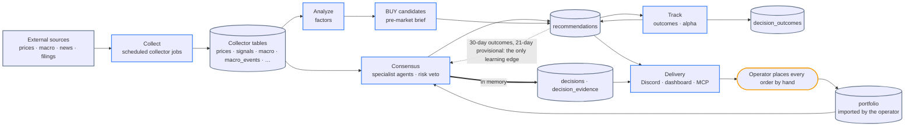
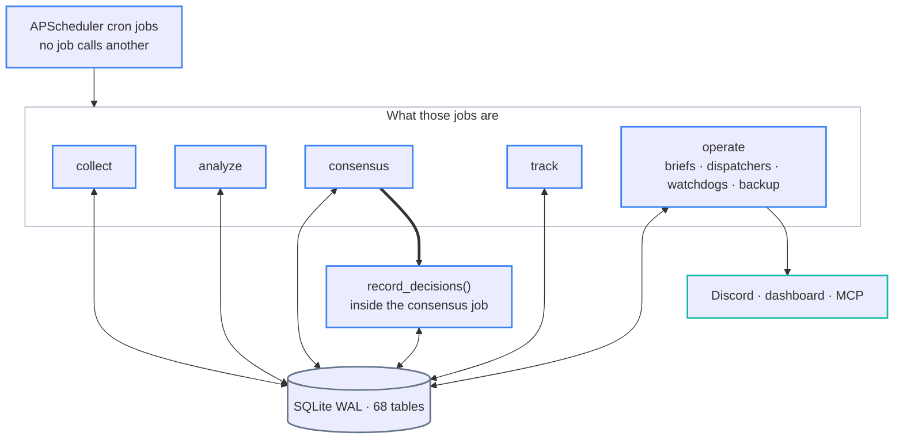
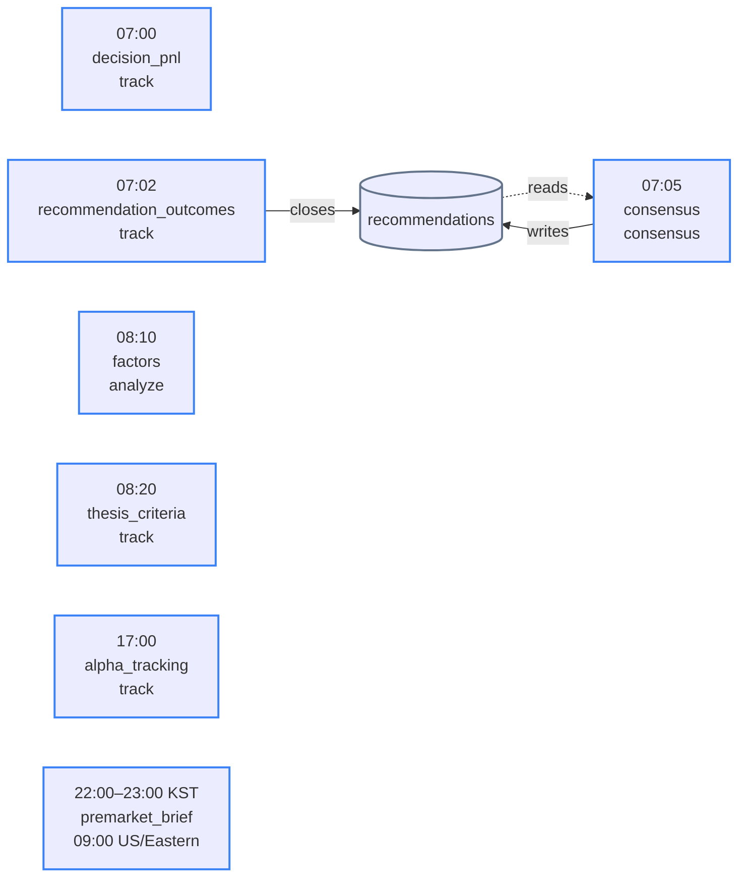
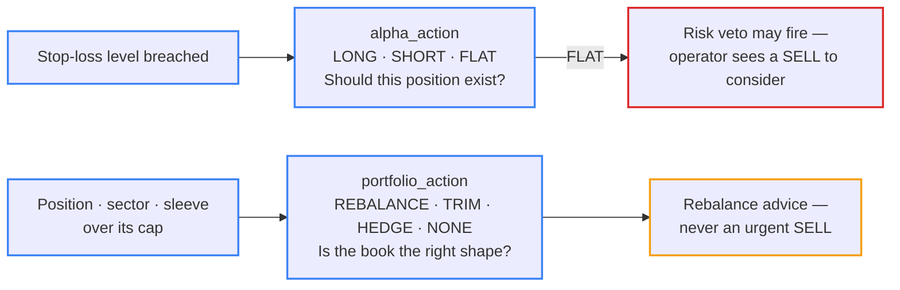

# 아키텍처 참조

*English (official) edition: [../ARCHITECTURE.md](../ARCHITECTURE.md)*

Nuri-Quant 내부 구조의 상세 참조 문서다. 데이터가 시스템 안에서 어떻게 이동하는지, 무엇이 언제 실행되는지, 각 구성 요소가 어디에 있는지를 다룬다. 이 문서의 서술은 코드와 대조해 확인한 것이다. `make verify-doc-counts` 가 이 문서의 수치를 코드와 대조하며(검사 위치 목록은 `scripts/verify/verify_doc_counts.sh`), [수치 claim 검증](#수치-claim-검증)에 그 수치를 재는 명령이 있다. 이 파일은 자동으로 로드되지 않는다. 여러 영역에 걸친 문제를 다룰 때 읽는다.

## 시스템 흐름

시스템은 공개 시장 데이터와 운영자의 보유 종목을 받아 보유 종목마다 날짜가 붙은 BUY / SELL / HOLD 를 만들고, 각 추천을 그 뒤 시장이 실제로 움직인 결과와 대조해 채점하며, 그 채점 결과를 다음 날의 agent 가중치에 되먹인다. 주문은 절대 내지 않는다.



다이어그램은 주 경로를 보여 준다. 표는 각 단계의 입력과 출력을 나열하며, 기록 관리용 쓰기(`collector_runs` 와 `pipeline_events` 의 lifecycle event)는 생략했다.

| # | 단계 | 실행 주체 | 읽는 것 | 쓰는 것 |
|---|------|---------|-------|--------|
| 1 | **Collect** | collector job. 주기는 장중 5분 간격부터 주 1회까지 ([일일 스케줄](#일일-스케줄)) | 외부 API; 보유 ticker 용 `portfolio`; `prices` (`technical` 용); 직전 `ark` 보유 내역 | `prices`, `signals`, `fundamentals`, `macro`, `macro_events`, `news`, `events`, `analyst_ratings`, `earnings_surprises`, `insider_trades`, `superinvestors`, `estimates`, `ark`, `ark_source_dates`, `etf_flows`, `institutional_flows` |
| 2 | **Analyze** | `factors` job | `prices`, `signals`, `fundamentals`, `macro` (Fear & Greed) | `factors` |
| 3 | **Consensus** | `consensus` job | `portfolio` 의 모든 ticker; collector 테이블; agent 가중치용 `recommendations` outcome | `recommendations` (`source` NULL) |
| 4 | **Decide** | consensus job 내부: `record_decisions()` 가 결과를 메모리로 받는다 | consensus 결과; `pipeline_events` (기록된 regime 변경이 있으면); regime · macro score · price target helper 를 거쳐 읽는 `macro`, `macro_events`, `prices`, `fundamentals`, `estimates`, `portfolio` | `decisions`, `decision_evidence` |
| 5 | **BUY candidates** | `premarket_brief` job | 최신 `factors` snapshot, `prices`, `signals`, `portfolio` (보유 종목은 제외), `pipeline_events` (재발행 cooldown), `theses` (라벨), VIX 와 regime 입력 | `recommendations` (`source='buy_candidate_emitter'`), `candidate_runs`, `candidate_ledger` |
| 6 | **Deliver** | brief job, outbox dispatcher, API, MCP server | `recommendations`, `decisions`, `macro`, `candidate_runs` 등 | Discord 메시지, `discord_outbox`, `market_postmortem` |
| 7 | **Track** | `decision_pnl`, `recommendation_outcomes`, `thesis_criteria`, `alpha_tracking`; `alpha_report` (ledger 를 봉인하는 operate job) | `recommendations`, `decisions`, `agent_decisions`, `prices`, `portfolio`, `theses`, `thesis_criteria`, `thesis_criteria_checks`, `signals`, `factors`, `fundamentals` | `recommendations.outcome_{7,14,21,30,60,90}d`, `decisions.pnl_*`, `agent_decisions`, `decision_outcomes`, `thesis_criteria_checks`, `theses.verdict`, `recommendation_seals` |
| 8 | **Learn** | 다음 consensus 실행 | `agent_verdicts` 와 함께 `recommendations.outcome_30d` (잠정값 `outcome_21d`) | 그 실행의 agent 가중치. 실행마다 다시 계산되며 `recommendations` 와 `decisions` 의 `scoring_detail` 에 보관된다 |

**Collect.** collector 는 각자의 스케줄에 따라 외부 API 를 읽고 각각 테이블 하나에 쓴다(여러 테이블에 쓰는 것도 있다). `technical` collector 는 `prices` 로부터 TA-Lib 지표를 계산한다. 운영자는 `config/portfolio.yaml` 에서 보유 종목을 가져오거나(`scripts/ops/import_portfolio.py`, `make setup` 이 실행하거나 수동으로 실행) portfolio API 로 수정한다. 데이터베이스 trigger 가 모든 insert 와 delete, 그리고 수량·계좌·ticker 를 바꾸는 모든 update 를 `portfolio_changes` 에 기록한다.

**Analyze.** 매일 실행되는 `factors` job 은 종가가 14개 이상인 모든 ticker 에 대해 factor composite 를 계산한다([점수 모델](#점수-모델) 참조). 이를 읽는 쪽에는 BUY 후보 emitter, held-add shadow check, thesis criteria, rebalance advisor 등이 있다. `factors` 를 읽는 consensus agent 는 없으며, 이 job 은 consensus job 뒤에 실행된다. regime 이나 macro score 테이블을 유지하는 scheduled job 은 없다. 각 소비처가 필요할 때 계산하고([레짐 분류기](#레짐-분류기-기본-6--특수-4) 참조), 결정 기록과 candidate run 은 자신이 사용한 값을 보관한다.

**Consensus 와 결정 기록.** consensus job 은 `portfolio` 의 모든 ticker 에 대해 specialist agent 를 실행하고, 그 verdict 에 가중치를 매기고, risk veto 와 divergence penalty 를 적용한 뒤([점수 모델](#점수-모델) 참조), ticker 당 하루 한 행씩 `recommendations` 에 쓴다. 이어서 같은 결과를 Python 객체로 `record_decisions()` 에 넘긴다. 이 함수는 시장 맥락과 가격 레벨을 더해 `decisions` 와 `decision_evidence` 에 쓴다. gate 는 적용하지 않는다.

**BUY candidates.** portfolio 밖의 후보는 다른 job 에서 나온다. `US/Eastern` 기준으로 스케줄되는 pre-market brief 가 `config/buy_signals.yaml` 과 `config/rules.yaml` (`vix_gate`) 의 gate 아래에서 최신 `factors` snapshot 을 채점하고, 발행된 후보를 `source='buy_candidate_emitter'` 로 `recommendations` 에 쓰고, 실행을 `candidate_runs` 와 `candidate_ledger` 에 기록하며(`candidate_runs` 는 하루 한 행이고 실행이 차단된 날에도 남는다), brief 를 Discord 에 게시한다.

**Deliver.** pre-market brief, daily report, holdings monitor 는 `DISCORD_WEBHOOK_URL` webhook 으로 바로 게시한다. post-market brief, 월간 alpha report, collector 실패 알림은 `discord_outbox` 에 적재되고, 채널 dispatcher job 이 채널별 webhook 으로 게시한다. dashboard 는 API 를 읽고([Dashboard API](#dashboard-api-projection-기반-5s) 참조), AI client 는 MCP server 를 읽는다([MCP 연동](#mcp-연동) 참조).

**Track.** outcome job 이 추천된 내용을 채점한다:

- `recommendation_outcomes` 는 진입가가 있는 모든 행에 대해 `recommendations.outcome_{7,14,21,30,60,90}d` 를 raw return 으로 채우고, 30일 outcome 으로 hit flag 를 설정한다.
- `decision_pnl` 은 `decisions.pnl_{7,30,60,90}d` 를 채우고 90일 시점에 `decisions.outcome` 을 설정한다.
- `alpha_tracking` 은 BUY·SELL 추천을 `agent_decisions` 에 mirror 하고(`decision_id = 'rec_{id}'`) `decision_outcomes` 를 쓴다. 그 내용은 자산군에 benchmark 가 있으면(`config/rules.yaml` 의 `measurement_mode.benchmark_by_asset_class`) 그 benchmark 와 대비한 7·14·30일 수익률, 그리고 alpha 다.
- `alpha_report` 는 모든 호스트에서 매일 실행되며 실행 event 를 기록한다. 마감된 추천 날짜를 `recommendation_seals` hash chain 에 봉인하고 월간 [`docs/STRATEGY.md`](STRATEGY.md) §3.11 진행 보고를 적재하는 일은 `NURI_ROLE=production` 인 곳에서만 한다.

**Learn.** feedback edge 는 정확히 하나다. consensus job 이 agent 가중치를 계산할 때 learning memory(`nuri/trading/agents/consensus/learning_memory.py`)는 look-back window 안에서 `agent_verdicts` 와 30일 outcome 이 있는 추천을 읽고, 잠정 21일 outcome 으로 fallback 하며, 각 agent 의 기본 가중치를 hit rate 에 따라 상한이 있는 범위 안에서 움직인다(`config/agents.yaml` `consensus.learning_memory`). `decision_outcomes`, `decisions.pnl_*`, `strategy_memory` 는 가중치에 들어가지 않는다.

**Operate.** 모든 매매는 운영자가 손으로 실행한다([`docs/STRATEGY.md`](STRATEGY.md) §7.1). `nuri/trading/execution/` 을 import 하는 다른 module 은 없다. 그 broker 들은 이 package 자체의 smoke-test 명령(`python -m nuri.trading.execution.broker`, 기본은 dry run)으로만 닿을 수 있다. `trades` 테이블은 `POST` / `PUT /api/trades` 와 `make trade-log` 명령으로 쓰인다.

### LLM 이 관여하는 곳

verdict 는 규칙 기반이다. agent, consensus, 결정 기록은 LLM 을 호출하지 않는다. 입력 하나와 부가 기능 셋에는 LLM 이 관여할 수 있으며, 언제나 로그가 남는 gateway `nuri/llm/openai_client.py` 나 로컬 모델을 거친다:

- **Macro headline 분류.** `macro_news` collector 는 `OPENAI_API_KEY` 가 설정돼 있으면 외부 모델로 headline 을 분류하고(regex fallback; `NURI_DISABLE_EXTERNAL_LLM=1` 이면 꺼진다) 결과를 `macro_events` 에 쓴다. 이 분류 결과는 한국 시장 agent, macro score 의 event 성분, 특수 regime 검사로 전달된다.
- **종목 리서치 briefing**([`docs/RESEARCH_BRIEFING.md`](RESEARCH_BRIEFING.md)), 로컬 Ollama 모델로 만드는 선택적 **portfolio report**, 그리고 post-market brief 가 선택적으로 붙이는, 과거 유사 세션에서 로컬 모델이 뽑은 **lessons** 는 추천 pipeline 에 들어가지 않는다.

### 수동 리서치 경로

`make validate`, `make regime`, `make strategy`, `make full-scan` 이 리서치 진입점이다. signal backtest(`make validate`)는 `signal_results.csv` 와 `signal_scorecard.csv` 를 `data/reports/YYYY-MM-DD/` 에 쓴다. strategy map(`make regime`)은 backtest 거래마다 진입 시점의 regime 라벨을 붙인다. strategy monitor(`make strategy`)는 `regime_transitions` 를 기록한다. `candidates.py` 는 이 regime 통계로 confidence 를 보정한다. `make full-scan` 은 backtest, strategy map, candidate screen 을 한 번에 실행한다. backtest 를 실행하는 scheduled job 은 없다. 주간 `memory_snapshot` job 은 최신 `signal_results.csv` 를 같은 시그널 × regime 분석을 거쳐 `strategy_memory` 로 읽어 들인다. 따라서 그 입력은 마지막 수동 실행 시점만큼만 최신이다.

## 런타임 토폴로지

런타임에는 orchestrator 가 없다. `nuri/scheduler.py` 는 서로 독립적인 APScheduler job 을 등록하고, 각 job 은 앞선 job 들이 쓴 테이블에서 입력을 읽는다.



모든 job 은 데이터베이스에서 입력을 읽고 결과를 데이터베이스에 다시 쓴다. 굵은 화살표는 유일한 in-memory hand-off 를 나타낸다. consensus job 은 결과를 테이블을 거치지 않고 Python 객체로 `record_decisions()` 에 넘긴다. operate job 도 쓴다. pre-market brief 는 BUY 후보를, alpha report 는 ledger seal 을 쓰고, dispatcher 는 outbox 를 갱신한다.

`decide`(#1619 전까지 이름은 `certify`)에는 자체 job 이 없다. `record_decisions()` 는 consensus job 안에서 실행된다. 예전에 이 스테이지에 있던 portfolio 전체 certifier 는 없어졌다 — brief, dashboard 의 health · violations endpoint, `/api/certify` 는 분리됐고 engine module 은 삭제됐다. dashboard 의 violations 는 `rebalance_advisor.detect_violations()` 에서 온다(prudential 제약만, 실행 관련 필드는 제거). `certifications` 테이블은 과거 기록용 ledger 로 남는다.

| 스테이지 | 스케줄 형태 | 읽는 것 | 쓰는 것 |
|-------|--------------|-------|--------|
| **Collect** | collector job. 주기는 장중 5분 간격부터 주 1회까지 | 외부 API; `prices` (기술 지표) | [시스템 흐름](#시스템-흐름)에 나열한 collector 테이블 |
| **Analyze** | job 1개: `10 8 * * *` 에 `factors` | `prices`, `signals`, `fundamentals`, `macro` | `factors` |
| **Consensus** | job 1개: `5 7 * * *` 에 `consensus` | `portfolio`, collector 테이블, `recommendations.outcome_30d` / `outcome_21d` (가중치용) | `agent_verdicts` 가 담긴 `recommendations` |
| **Decide** | 전용 job 없음. `record_decisions()` 가 consensus job 안에서 실행된다(위 참조) | 메모리로 넘겨받은 consensus 결과; [시스템 흐름](#시스템-흐름)에 나열한 시장 맥락 테이블 | `decisions`, `decision_evidence` |
| **Track** | `decision_pnl`, `recommendation_outcomes`, `thesis_criteria`, `alpha_tracking` | `recommendations`, `decisions`, `agent_decisions`, `prices`, `portfolio`, `theses`, `thesis_criteria`, `thesis_criteria_checks`, `signals`, `factors`, `fundamentals` | `recommendations.outcome_{7,14,21,30,60,90}d`, `decisions`, `agent_decisions`, `decision_outcomes`, `thesis_criteria_checks`, `theses.verdict` |

스테이지 디렉터리는 `nuri/collectors`, `nuri/analysis`, `nuri/trading/agents`, `nuri/trading/engine`, `nuri/trading/recommend` 다. 이 경계를 넘는 import 는 함수 본문 안에서만 허용되고 module level 에서는 절대 허용되지 않으며, 하나하나 이유와 함께 allowlist 에 등재돼야 한다. `tests/core/test_cross_stage_imports.py` 가 이를 양방향으로 강제한다.

### 일일 스케줄

스테이지 이름은 데이터 의존 관계를 나타낼 뿐 실행 순서가 아니다. job 을 이어 붙이는 것이 없으므로 스케줄은 job 들을 다른 순서로 실행한다:



outcome tracking 은 07:05 의 consensus job 보다 앞선 07:02 로 스케줄되므로, agent 가중치에 그날 아침까지 마감된 outcome window 가 들어갈 수 있다. 그 완료를 기다리는 것은 없으며, 종가가 아직 수집되지 않은 window 는 이후 실행 때까지 비어 있다. `factors` 는 consensus 뒤에 실행되지만 이를 읽는 agent 가 없으므로 문제가 없다. 이를 읽는 쪽(08:20 thesis criteria, 08:30 held-add shadow check, 저녁의 pre-market brief)은 모두 그보다 늦게 실행된다. `premarket_brief` 는 `US/Eastern` 기준으로 스케줄되므로 EDT 에는 22:00 KST, EST 에는 23:00 KST 에 실행된다.

시각은 호스트 로컬 시간이며, production 호스트는 KST 로 동작한다. 평일 cron 은 휴장일 달력을 참조하지 않으므로 거래소 휴장일에도 실행된다. KST 자정 이후에 걸리는 미국 세션 job(가격 polling 과 refresh, `technical`, `ark`, 미국 post-market brief)은 KST 기준 화요일부터 토요일까지 실행된다. 주간 batch(fundamentals, 13F filing, estimates, analyst rating, 가격 backfill)는 일요일에 실행된다. 어떤 스테이지 job 이든 단독으로 다시 실행할 수 있다. 입력을 데이터베이스나 외부 API 에서 읽기 때문이다. 결정 기록은 예외다. 입력을 메모리로 받으므로 consensus 를 다시 실행해야만(`make consensus`) 다시 만들어진다.

### 프로세스와 배포

production 은 호스트 한 대에서 launchd(`scripts/launchd/`) 아래 실행된다. scheduler, API, dashboard(`npm run start`), Discord bot, autopull receiver, state replicator, heartbeat watchdog, SRE scan 용 LaunchAgent 가 있고, 여기에 머신 자체를 보고하는 system LaunchDaemon(`system/com.nuri-quant.machine-alive.plist`)이 더해진다. `health-check` plist 는 디렉터리에 남아 있지만 설치하지 않는다 — 그 schema·table·writer-role 점검은 SRE detector 로 돈다(#939, #952). `scripts/ops/health_check.sh` 는 Discord `/health` 명령으로 필요할 때 실행된다.

- **Autopull**(`scripts/deploy/autopull_receiver.sh`, 5분마다)은 `origin/main` 으로 fast-forward 하며, dirty tree 나 non-fast-forward 는 거부한다. 새 commit 은 그 commit 의 main CI(push run, 또는 `GITHUB_TOKEN` 이 한 merge 에 `main-ci-catchup.yml` 이 dispatch 한 run, #1812)가 success 일 때만 배포하고, 런이 없거나 진행 중이거나 빨갛거나 API 를 못 읽으면 보류한 뒤 다음 cycle 에 다시 본다(#1808). `pyproject.toml` 이나 `uv.lock` 이 바뀌면 `uv sync` 를 실행하고, `nuri/` 아래 Python 코드나 의존성이 바뀌면 scheduler, API, Discord bot 을 재시작한다. fetch 가 성공하면 각 cycle 은 마지막 `frontend/` commit 이 현재 build 보다 새로울 때 dashboard 도 다시 build 하고 재시작한다(`scripts/deploy/build_frontend.sh`, #1462). build 가 실패한 commit 은 새 `frontend/` commit 이나 `--retry` 가 있기 전까지 재시도하지 않는다. 대기 중인 migration 은 재시작된 scheduler 가 시작할 때 `init_db()` 가 적용한다. autopull 자신은 reminder 로그만 남긴다. `config/` 만 바꾸는 commit 은 아무것도 재시작하지 않는다. `rules.yaml` 과 `agents.yaml` 은 import 시점에 읽히므로 각 프로세스는 다음 재시작 때 이를 반영한다(scheduler 는 매일 08:40 에 스스로 재시작한다).
- **Replica**(`scripts/deploy/state_replicator.sh`, 매시)는 `VACUUM INTO` snapshot 을 개발 호스트의 `data/replicas/` 로 복사한다. MCP server 가 이를 읽는다.
- **Heartbeat.** 호스트 안에서는 scheduler 가 1분마다 heartbeat 파일을 쓴다. watchdog 은 이 파일이 30분보다 오래되면 알림을 보내고 scheduler 를 재시작하며, backup 이 오래됐을 때와 API·dashboard 포트가 죽었을 때도 알린다. 호스트 밖으로는 scheduler(`NURI_ROLE=production` 일 때만)와 머신 LaunchDaemon 이 각자 자기 ref(`refs/nuri/heartbeat-mini`, `refs/nuri/machine-mini`)에 10분마다 빈 commit 을 force-push 한다. `heartbeat-watch.yml` 은 scheduler 의 ref 가 45분보다 오래되면 `#ops` 에 게시하고, 머신 ref 의 나이로 조용한 scheduler 와 꺼진 머신을 구분한다. 다만 GitHub 이 schedule 을 시작할 때만 검사하고 그 간격은 몇 시간일 수 있어, 죽은 호스트가 몇 시간 동안 알려지지 않을 수 있다. 이 지연은 받아들였다(#1848).

## 결정 축

깨진 투자 thesis 에 대응하는 규칙과 position sizing 에 대응하는 규칙을 분리해 둔다(`nuri/core/axis.py`).

| 축 | 값 | 촉발 요인 |
|------|--------|--------------|
| **alpha** | `LONG` / `SHORT` / `FLAT` | thesis 의 변화. stop-loss 이탈은 `FLAT` 으로 가는 유일한 기계적 경로다. |
| **portfolio** | `REBALANCE` / `TRIM` / `HEDGE` / `NONE` | sizing. 집중도, sector cap, 실험 sleeve 한도 위반은 여기서 해소되며 결코 urgent SELL 을 만들지 않는다. |



risk veto 는 `alpha_action` 을 읽는다(alpha action 이 없는 verdict 에 한해서만 SELL action 으로 fallback 한다). 따라서 비중이 지나친 position 은 rebalancing 권고로 이어질 수는 있어도 매도 지시로는 절대 이어지지 않는다.

## 점수 모델

- **Consensus**(`nuri/trading/agents/consensus/scoring.py`): 각 agent 의 표는 가중치 × confidence 만큼 반영된다. **risk veto** 는 표결을 override 한다. risk agent 의 `alpha_action` 이 `FLAT` 이고(alpha action 이 없는 verdict 라면 action 이 SELL 이고) confidence 가 `consensus.risk_veto_threshold` 이상이면 결과는 SELL 이다. degraded 이거나 기권한 risk verdict 는 veto 할 수 없으며, `scoring_detail` 에 veto 를 쓸 수 없었다는 사실이 기록된다. **divergence penalty** 는 technical agent 가 `consensus.divergence_technical_threshold` 이상의 confidence 로 반대할 때 BUY 나 SELL 을 HOLD 로 낮춘다(두 값 모두 `config/agents.yaml` 에 있다). `scoring_detail.final_action_source` 는 어느 규칙이 결정했는지 기록한다: `weighted_sum`, `risk_veto`, `divergence_penalty`.
- **Factor composite**(`nuri/quant/factors/composite.py`): momentum 0.30, value 0.25, quality 0.25, sentiment 0.20. sentiment 는 시장 전체의 Fear & Greed 값이므로 순위가 아니라 점수 수준을 움직인다. `factors` job 이 매일 08:10 에 계산해 저장한다.
- **BUY 후보 점수**(`config/buy_signals.yaml`): factor composite 에 5일 momentum, RSI, 30일 breakout 을 결합한다. cross-sectional relative strength 와 dollar-volume surge 는 계산해 evidence 로 보여 주지만, walk-forward test 로 검증되기 전까지는 가중치가 0 이다. VIX 가 `vix_gate` 차단 수준을 넘으면 실행이 멈춘다. VIX 를 알 수 없거나 오래됐거나 caution 구간이면 배분이 절반으로 줄어든다.
- **시그널**(`config/signals.yaml`): backtest detector 가 쓰는 ticker 단위 actionable 시그널 19개와, `actionable: false` 로 표시된 shadow 시그널 3개. 시장 전체 2개(수익률 곡선 역전, HY-OAS 확대)는 경고로만 surface 되고, ticker 단위 `short_squeeze` 는 scorecard 에만 잡히고 후보가 되지 않는다(#1911).

## 데이터베이스 접근

`sqlite3` 를 import 하는 module 은 `nuri/core/db/connection.py` 하나뿐이다. DB 파일은 `data/portfolio.db` 다(WAL 모드, `NURI_DB_PATH` 로 override). 모든 upsert 함수는 선택 인자 `db_path` 를 받으며, 테스트는 격리를 위해 이를 `tmp_path` 의 파일로 지정한다. schema 버전 관리에는 `schema_version` 테이블과 `_MIGRATIONS` 목록을 쓴다. job 들은 테이블을 통해 데이터를 주고받으며, 예외는 [런타임 토폴로지](#런타임-토폴로지)에서 설명한 in-memory hand-off 하나뿐이다.

주요 DB 접근 패턴:

- `get_db()`: context manager. 성공하면 commit 하고 예외가 나면 rollback 한다.
- `query(sql, params)` → `list[dict]` (`readonly=True` 는 engine 수준에서 쓰기를 막는다).
- `query_df(sql, params)` → pandas DataFrame. 두 reader 모두 `nuri.core.db` 가 re-export 하는 sqlite 오류 타입을 raise 한다.
- `upsert_*()`: 테이블마다 함수 하나(prices, portfolio, fundamentals 등).
- `replace_portfolio_account(account, records)`: YAML → DB 동기화를 위해 DELETE + INSERT 를 한 transaction 으로 수행한다.

## 시그널 시스템 (시그널 22개: actionable 19 + shadow 3, YAML 기반 registry)

`signal_backtest.py` 는 detector registry 를 쓴다. Python detector 함수를 그 metadata(threshold, 분류, hold_days)와 분리해 둔다. metadata 는 `config/signals.yaml` 에 있고 `nuri/core/signal_config.py` 가 로드한다. YAML 에는 항목 22개가 있다. 아래의 ticker 단위 시그널(actionable 19개 + ticker 단위 shadow `short_squeeze`)과 시장 전체 shadow 시그널 2개(`actionable: false`, detector 는 `nuri/quant/validation/market_signals.py`)다. ticker 단위 시그널은 4개 category 로 나뉜다:

- **가격 기반** (10): rsi_oversold/overbought, macd_golden/dead, sma_golden/dead, bb_bounce, volume_spike, gap_up, gap_down
- **Macro 기반** (3): vix_reversal, pcr_reversal, yield_curve_recovery (`merge_macro_data()` 필요)
- **데이터 의존** (2): insider_cluster, short_squeeze (`merge_data_signals()` 필요. short_squeeze 는 shadow — #1911 전까지 리더가 잘못된 키를 읽었고 공매도 이력은 2026-04 부터다)
- **차트 패턴** (5): macd_bullish_turn, macd_bearish_turn, bb_squeeze_breakout, near_52w_low_bounce, volume_profile_resistance

`SIGNAL_DEFINITIONS` 는 `_build_signal_definitions()` 가 YAML 과 detector registry 로부터 만든다. threshold 를 바꿀 때는 YAML 수정만 필요하다. backtest 는 스케줄이 아니라 [수동 리서치 경로](#수동-리서치-경로)에서 실행된다.

**Macro 데이터 특이점**: yfinance fallback 에는 `us_3m_yield`(FRED)가 없고, 거기서는 `^IRX`(13주 T-Bill)가 `us_2y_yield` 로 저장된다. 그래서 `merge_macro_data()` 는 `us_3m_yield` 가 비어 있으면 `us_2y_yield` 를 조회한다.

## 레짐 분류기 (기본 6 + 특수 4)

기본 regime 은 `{bull,bear,sideways}_{low,high}_vol` 이다. SMA50/200 대비 SPY 의 위치와 VIX 로부터 도출하며, adaptive hysteresis(평소 5일, VIX ≥ 25 이면 2일)를 적용한다.

특수 regime 은 우선순위 순서대로 기본 `regime` 필드를 덮어쓴다: euphoria, stagflation, recovery, sector_rotation. `nuri/quant/regime/classifier.py` 참조. 어떤 detector 도 발동하지 않아도 `macro_events` 점수가 강하면 특수 regime 으로 승격될 수 있다. sector rotation 검사는 두 window 가 같은 날짜에 끝날 때만 SPY 의 20일 수익률을 각 sector ETF 의 20일 수익률과 비교한다. 수집이 멈춘 ETF 는 오래된 window 와 비교하지 않고 건너뛴다(#1631).

regime 은 scheduled job 이 저장하지 않고 각 소비처가 필요할 때 계산한다(`classify_regime()`, scope 단위 memoize). live 모드에서는 가장 최근 SPY bar 가 120시간보다 오래됐거나 SPY bar 가 200개 미만이면 `None` 을 반환하며, 소비처는 이를 `unknown` 으로 보고한다.

`RegimeState.trend` 와 `.volatility` 는 항상 기본 분류를 반영한다. `details["special_regime"]` 은 `None` 이거나 특수 regime 이름이고, `details["base_regime"]` 에는 항상 기본 regime 이름이 들어 있다.

`REGIME_ALLOCATION` 은 regime 10개를 모두 다룬다. `position.py` 는 `REGIME_ALLOCATION` 에서 regime 을 찾는다. 등록되지 않은 regime 은 fail closed 로 처리된다(진입이 misaligned 로 취급된다).

## 결정 엔진

`nuri/trading/engine/` 에는 결정 기록(`decisions.py`), 한 phase 에 필요한 데이터가 있는지 확인하는 data-readiness gate(`gate.py`, `REQUIRED_BY_PHASE`), symmetric amplifier gate(`amplifier_gate.py`; 어떤 production 코드도 호출하지 않는 shadow skeleton 이며 `config/rules.yaml` 의 `symmetric_amplifier.enabled: false` 로 꺼져 있다), conflict 탐지, learning memory, thesis verdict roll-up 이 있다. hard veto 는 여기 없다. hard veto 는 consensus scoring 의 risk veto 다([점수 모델](#점수-모델)). portfolio 전체 certification layer 는 2026-10 에 폐기됐다([`docs/STRATEGY.md` §6](STRATEGY.md), #1619).

[수동 리서치 경로](#수동-리서치-경로)의 confidence scoring 은 `nuri/trading/recommend/candidates.py` 에 있으며, regime 승률, profit factor, learning memory drift, conflict penalty, regime 적합도를 결합한다. 수식: [`docs/STRATEGY.md` §3.3](STRATEGY.md).

## Pipeline 관찰 가능성

`nuri/core/events.py` 는 append-only event journal 이다. `emit_event()` 는 상태 전이를 기록하며 `payload` 에는 항상 유효한 JSON 을 쓴다(#935). `get_pipeline_status()` 는 5개 스테이지의 상태를 반환하고, `get_timeline()` 은 chain 추적용 `causation_id` 가 포함된 이력을 반환한다.

`nuri/core/freshness.py` 는 데이터 freshness SLA 를 구현한다. `check_freshness(key)` 는 PASS, WARN, FAIL 중 하나를 반환한다. threshold(source 별 `warn_hours` / `fail_hours`)는 `config/freshness.yaml` 에 있다(#1181). `_load_config()` 가 import 시점에 이를 주입하고 key 집합을 `FRESHNESS_POLICIES` 와 양방향으로 대조한다. key 가 빠지거나 남으면 `ValueError` 를 raise 한다. query 와 라벨은 코드에 남는다. `VERDICT_GATE_KEYS` 와 `stale_verdict_inputs()` 는 dashboard verdict 의 stale gate 에 입력을 공급하는데, 이것이 freshness 가 실제 운영에서 무언가를 막는 유일한 곳이다. 그 밖의 곳에서는 표시되거나 incident 로 올라갈 뿐이다(차단하는 `FreshnessGatekeeper` actor 는 dormant 상태다). FAIL 만 막는다. 주말과 휴일의 데이터 나이는 정상이므로 WARN 은 통과한다.

`nuri/core/pipeline.py` 는 스테이지 lifecycle event 를 기록할 뿐 orchestration 은 하지 않는다. `STEP_DEPENDENCIES` 는 어떤 스테이지가 다른 스테이지보다 먼저 완료돼야 하는지 선언한다. analyze 와 consensus 는 각각 collect 에 의존하고, decide 와 track 은 각각 consensus 에 의존한다. `run_step()` 은 이를 검사하고 event 를 기록하지만 실제로 강제하지는 않는다. scheduler 와 Overview 의 data-refresh worker 가 `warn_only=True` 를 넘기므로, 충족되지 않은 의존성은 dependency warning 으로 기록되고 job 은 그대로 실행된다(#894). scheduler 는 `_STAGE_OF_JOB` 에 나열된 모든 job(collect, analyze, consensus, track)을 `run_step()` 으로 실행한다. decide 에는 job 이 없으므로 자체 lifecycle event 를 기록하지 않는다.

Pipeline 제어 API(`nuri/api/routes/pipeline.py`, `nuri/api/routes/pipeline_refresh.py`):

- `GET /api/pipeline/status`: 5개 스테이지의 lifecycle 상태와 기록 건수. Decide 는 `execution_mode` 와 별도의 최신 ledger `artifact`(date/count/status)도 싣는다
- `GET /api/pipeline/timeline`: event log. `?step=` 는 `pipeline_events.step` 의 어떤 값이든 받고(5개 스테이지와 `recommend`·`alpha_report` 같은 도메인 스텝), 모르는 값이면 빈 목록이다
- `GET /api/freshness`: 데이터 freshness 보고
- `GET /api/pipeline/refresh`: 지원하는 data-refresh job 과 프로세스 로컬 요청 상태
- `POST /api/pipeline/refresh`: 인증이 필요한 background 데이터 수집/재계산. HTTP 202, 순서가 정해진 job, lifecycle event, heavy slot. consensus, 결정 기록, outcome tracking 은 실행하지 않는다.

매매 실행 API(`nuri/api/routes/trades.py`):

- `POST /api/trades`: 매매 실행을 기록한다
- `GET /api/trades`: 매매 목록(선택적 ticker filter)
- `PUT /api/trades/{id}`: 청산 정보 갱신

## Dashboard API (projection 기반, <5s)

`/api/dashboard` 는 `recommendations` 의 최신 consensus 행(scheduled consensus job 이 매일 쓰거나 `make consensus` 가 쓴다)을 같은 날짜의 `decisions` 와 함께 읽고, regime 과 macro score 는 요청 시점에 계산한다. 응답 전체는 프로세스 안에 5분간 cache 되며, portfolio 가 바뀌면 만료 전에 버려진다. 응답에는 `freshness` 와 `pipeline_status` 가 들어 있어 dashboard 가 데이터 나이를 보여 줄 수 있다. 한 줄 `verdict` 에는 stale gate 가 걸려 있다(#1181). `verdict_gate` 입력(`config/freshness.yaml`) 중 하나라도 FAIL-stale 이면 응답에 `verdict_level: "stale"` 과 `verdict_stale_inputs` 가 실리고, verdict 문구는 조언 대신 stale 입력의 이름을 댄다.

### Overview

`/` 는 Overview(`frontend/src/app/(overview)/`)다. `/dashboard-next` 미리보기(#1658)로 시작해 #1698 에서 기존 dashboard 를 대체했고, 예전 주소는 `/` 로 redirect 된다. 시장 맥락, 보유 종목 점검, portfolio 구성, freshness, pipeline 관측을 한데 모은다. portfolio 도넛은 모든 그룹을 포함하고, API 가 제공하는 한국어 이름을 쓰며, 알 수 없는 평가 입력을 보존한다. viewport 기반 레이아웃은 Overview 에만 적용되고, 다른 모든 페이지는 1,600px container 상한을 유지한다. data contract, refresh 동작, 반응형 기준점, 테스트, 한계는 [Overview 구현 및 운영 안내](OVERVIEW.md)를 참조한다.

### 종목 리서치 미리보기

`/ticker-next/[symbol]` 은 공개 리서치와 저장된 시스템 판단을 분리한다. 기업·펀드·fallback 보고서는
`ReportFrame` / `ReportSection` 을 공유한다. 공개 briefing 생성은 중앙 LLM gateway 를 쓰며
consensus 를 결코 다시 실행하지 않는다. 리서치 route 는 `ticker_research.py` 에, 공개 데이터와
생성된 보고서는 `external_analysis` 에, source 등록은 `config/research_sources.json` 에 있다.
v9 prompt, evidence 검사, cache 상태, 알려진 한계는 [종목 리서치와 공개 브리핑](RESEARCH_BRIEFING.md)을
참조한다.

## API (70 endpoints)

`nuri/api/routes/` — 70 REST endpoints, 포트 8001. route module 전체의 `@router.get/post/put/delete/patch` decorator 를 센 값이다. `nuri/api/main.py` 가 세 개를 더 선언한다(`GET /`, `GET /api/health`, `POST /api/auth/token`). FastAPI 의 `/docs`, `/redoc`, `/openapi.json`, `/docs/oauth2-redirect` 는 제외한다. Swagger UI 는 `http://localhost:8001/docs` 에 있다. Server-sent events 는 `/api/stream` 에서 제공한다(30초 간격). 몇몇 read route 는 저장된 결과를 projection 하지 않고 실시간으로 계산한다: regime, macro score, `/api/opportunities`(BUY 후보 평가를 read-only 로 다시 실행한다), candidate screen.

### Overview 가 읽는 endpoint

| Endpoint | Method | 용도 |
|----------|--------|---------|
| `/api/dashboard` | GET | 시장 맥락, stale gate 가 걸린 한 줄 verdict, freshness, pipeline 상태([Dashboard API](#dashboard-api-projection-기반-5s) 참조) |
| `/api/actions` | GET | 우선순위별 오늘의 action(urgent / check / portfolio / hold). 연금·IRP 계좌는 제외하고 중복은 제거한다. 각 항목에는 `decision_id` 와 `as_of` 가 실려 있어(`decisions` 와의 같은 날짜 LEFT JOIN, #1182) frontend 가 `/decisions/{id}` evidence chain 으로 링크할 수 있다 |
| `/api/opportunities` | GET | portfolio 밖의 후보: scanner 관측(`observations`)과 BUY 후보 emitter 의 분류(`system`: qualified / below_threshold / excluded / blocked / not_scored, #1683) |
| `/api/backtest/equity` | GET | equity curve, drawdown, 지표(Recharts 용 경량 payload) |

`/api/coverage`(#297)와 `/api/market-context` 는 #1816 에서 은퇴했다. #1698 에서 기존 dashboard 가 삭제된 뒤로 아무도 호출하지 않았다. universe coverage 검사는 `scripts/verify/check_universe_coverage.py` 로 남고, Explore 페이지의 `/api/tickers/market-context` 는 별개 route 다.

## Scheduler

`nuri/scheduler.py` 는 56 cron jobs in the `SCHEDULES` list 를 정의하고, 여기에 1분 간격 `heartbeat` interval job 이 하나 더 있다. 시각은 호스트 로컬 시간이며(production 호스트에서는 KST), job 이 자기 timezone 을 지정한 경우만 다르다(`premarket_brief` 는 `US/Eastern` 으로 실행된다). collector import 는 import 시점의 부작용을 피하려고 `_dispatch_collector()` 안으로 지연된다. job 의 pipeline 스테이지는 `_STAGE_OF_JOB` 에서 오며, 스테이지가 지정된 job 만 lifecycle event 를 기록한다. cron job 은 5분의 misfire grace 를 허용하며, 프로세스가 내려가 있는 동안 놓친 실행 시각은 나중에 실행되지 않는다. 매일 도는 `self_restart` job(08:40 KST)은 누수된 yfinance file descriptor 를 회수하려고 프로세스를 재기동한다. 주간 `prune_reports` job(일요일 03:30 KST)은 30일보다 오래된 `data/reports/` 날짜 디렉터리를 지운다. 단, 가장 최신 디렉터리, 소비되는 산출물(`signal_scorecard.csv`, `signal_results.csv`, `superinvestor_scorecard.csv`, `evidence/` — 이들은 수동 `make validate` / `make full-scan` 으로만 다시 생성된다)마다 그것을 담은 가장 최신 디렉터리, 그리고 날짜가 아닌 하위 디렉터리는 남긴다(#1654). `stock_us_freshness` job(06:10 과 06:40 KST, 화요일부터 토요일까지)은 SPY 측정 benchmark 와 `freshness_tickers` 를 최신으로 유지한다(§3.11).

## 환경 변수

따로 적지 않은 한 `.env` 에서 설정한다(`.env.example` 참조). 개발 환경에서는 모든 key 가 선택 사항이다. credential 이 없는 collector 는 건너뛰거나 key 가 필요 없는 source 로 fallback 한다.

**데이터 소스**

- `FRED_API_KEY`: FRED macro 데이터(yfinance fallback)
- `FINNHUB_API_KEY`: 미국 institutional flow
- `KIS_PROD_APP_KEY` / `KIS_PROD_APP_SECRET`, `KIS_PAPER_APP_KEY` / `KIS_PAPER_APP_SECRET`, `KIS_PROD_ACCOUNT` / `KIS_PAPER_ACCOUNT` / `KIS_HTS_ID`: KIS Open API. credential 은 환경 변수, 그다음 `config/kis/kis_devlp.yaml`(gitignored), 그다음 home 디렉터리 fallback 순으로 찾는다([KIS_INTEGRATION.md](KIS_INTEGRATION.md))
- `TOSS_API_KEY` / `TOSS_SECRET_KEY` / `TOSS_ACCOUNT_SEQ`: Toss Open API(IP allowlist: 다른 머신은 403 을 받고, 그러면 macro collector 는 USD/KRW 를 FRED 나 yfinance 에서 가져온다)

**전달**

- `DISCORD_WEBHOOK_URL`: pre-market brief, daily report, holdings monitor 알림, `make full-scan` 공지, watchdog fallback 용 직접 webhook
- `DISCORD_WEBHOOK_BRIEF` / `_OPS` / `_INCIDENTS` / `_ROLLOUT` / `_AGENT_CONTROL` / `_AGENT_DEV_LOG`: outbox dispatcher 가 쓰는 채널별 webhook
- `DISCORD_BOT_TOKEN` / `DISCORD_GUILD_ID`: inbound Discord bot
- `DISCORD_TOKEN` / `DISCORD_CHANNEL_ID`: 수동 발송기 `python -m nuri.alerts.discord_bot --bot` 의 bot 모드
- `TELEGRAM_BOT_TOKEN` / `TELEGRAM_CHAT_ID`: `make full-scan` 의 Telegram 공지 전용

**LLM**

- `OPENAI_API_KEY`: 외부 gateway(`nuri/llm/openai_client.py`): macro headline 분류와 리서치 briefing
- `NURI_DISABLE_EXTERNAL_LLM`: `1` 로 설정하면 외부 gateway 가 꺼지고, 호출자는 fallback 한다
- `OLLAMA_HOST` / `OLLAMA_MODEL`: 로컬 Ollama server 를 통한 LLM report(`OLLAMA_HOST` 가 설정되지 않으면 꺼지고, 설정한 값은 localhost 를 가리켜야 한다. `OLLAMA_MODEL` 기본값은 `gemma4:26b-a4b-it-qat`)
- `LLAMA_MODEL_PATH`, `NURI_LLM_LOCAL_URL`, `NURI_LLM_LOCAL_MODEL`, `NURI_LLM_CODEX_MODEL`: 로컬 모델과 consult 도구

**API 와 dashboard**

- `API_SECRET_KEY`: JWT 서명 key(production 에서는 필수, 개발에서는 선택). 설정하지 않으면 `nuri/api/auth.py` 가 시작할 때마다 새 `secrets.token_hex(32)` 를 만들므로, 재시작하면 발급된 JWT 가 모두 무효가 되고 dashboard 사용자는 다시 로그인해야 한다. `python3 -c "import secrets; print(secrets.token_hex(32))"` 로 생성한다. `make deploy-mini` 가 로컬 `.env` 를 Mac mini 로 복사하므로 두 `.env` 파일에 같은 값이 있어야 한다. 그렇지 않으면 배포가 production 을 시작마다 바뀌는 임의 key 로 되돌린다.
- `API_AUTH_ENABLED`(기본 `false`), `API_KEY`, `API_PORT`, `CORS_ORIGINS`, `NURI_API_HEAVY_SLOTS`: API 인증, 포트, CORS, heavy route slot 수
- `DASHBOARD_PASSWORD`: Next.js 인증(설정하지 않으면 공개). 설정되지 않은 동안 `POST /api/auth/token` 은 503 을 반환한다. frontend 의 cookie 서명 key `AUTH_SECRET` 은 `frontend/.env.local` 에 있다.

**런타임과 배포**

- `NURI_DB_PATH`: SQLite DB 위치 override(기본 `data/portfolio.db`)
- `NURI_ROLE`: 값 `production` 이 두 가지를 gate 한다. §3.11 ledger 기반 surfacing(설정됐을 때만 월간 alpha 진행 보고가 `#brief` 에 적재된다)과 off-box dead-man heartbeat push(`nuri/alerts/offbox_heartbeat.py`, #1191 option C, 개발 머신에서는 no-op)다. adjudication 은 Mac mini DB 에서 수행되고 MBP 는 read replica 이므로, 개발 환경의 수치가 brief 에 닿으면 안 된다. 이 값은 `.env` 가 아니라 `scripts/launchd/com.nuri-quant.scheduler.plist` 의 `EnvironmentVariables` 아래에 설정한다. `make deploy-mini` 가 MBP 의 `.env` 로 mini 의 `.env` 를 덮어쓰므로 `.env` 에 둔 값은 다음 배포 때 덮어써진다(`DEV2_HOST` 도 마찬가지다).
- `NURI_SCHEDULER_LOG_DIR` / `NURI_SCHEDULER_LOG_DISABLE_FILE`, `NURI_DISCORD_INBOUND_DIR`: 로그와 inbound 메시지 위치
- `MACMINI_HOST` / `MACMINI_USER` / `MACMINI_PATH`, `DEV2_HOST`: 배포와 복제 대상
- `ALPACA_API_KEY` / `ALPACA_SECRET_KEY` / `ALPACA_BASE_URL`: broker smoke-test CLI 전용(기본은 paper endpoint, DryRun fallback)

## DB 스키마 (SQLite, WAL 모드)

전체 테이블 수는 [런타임 토폴로지](#런타임-토폴로지) 다이어그램에 한 번만 나오며, `make verify-doc-counts` 가 그곳에서 검사한다(77 migrations as of 2026-10-12). 주요 테이블:

| 테이블 | 용도 |
|-------|---------|
| `prices` | ticker 별 OHLCV 일봉. scheduled 실행은 최근 며칠을 가져오고, 주간 backfill 이 1년을 덮으며, 그보다 긴 이력은 필요할 때 로드한다. `source` 는 기록한 writer 를 나타낸다(`yfinance` / `pykrx` / `kis`, #1727 — 같은 (ticker, date) 를 나중에 쓴 writer 가 대체한다). `close` 는 절대 NULL 이 아니다. `upsert_prices` 가 yfinance 의 미확정 반쪽 행을 버리고(#1480), migration 66 이 그 이전에 쓰인 행을 삭제했다(#1630) |
| `portfolio` | 보유 종목(account, ticker, quantity, avg_price, currency, sector) |
| `portfolio_changes` | #1720 append-only 보유 수량 로그. 모든 `portfolio` INSERT·DELETE 와 quantity·account·ticker 를 바꾸는 모든 UPDATE 에서(writer 무관) SQLite trigger 가 쓰며, `changed_at` 은 KST wall-clock 이다. 계좌 import(DELETE+INSERT)는 보유 종목마다 −old/+new 쌍을 남기고, 수량이 그대로면 합이 0 이 된다. 보유 데이터: production DB 에만 있고 MCP `ALLOWED` 에는 없다 |
| `macro` | FRED 지표, VIX, USD/KRW, Fear & Greed, put/call ratio, crypto, retail sentiment 시계열 |
| `signals` | TA-Lib 기술 지표 |
| `fundamentals` | PE, ROE, 마진, 성장률, beta |
| `superinvestors` | 13F 보유 내역(Buffett 등) |
| `estimates` | analyst consensus + 목표 주가 |
| `recommendations` | (date, ticker) 당 한 행: 보유 종목별 consensus verdict(`source` NULL)와 발행된 BUY 후보(`source='buy_candidate_emitter'`). `outcome_{7,14,21,30,60,90}d` 는 tracker 가 채운다 |
| `recommendation_seals` | #1718 마감된 `recommendations` 날짜에 대한 일 단위 hash chain(동결된 field 목록 v1, `outcome_*` / `hit*` / `tracked_at` / `regime` 제외). production `alpha_report` job 이 매일 봉인한다. `python -m nuri.core.db.ledger_seal` 이 검증한다(read-only). 월간 alpha 줄이 chain head 를 머신 밖으로 실어 나른다 |
| `decisions` | #178 Decision Intelligence — 풍부한 기록(regime/macro/event/agent_verdicts/scoring_detail/dissent/pnl_7/30/60/90d) |
| `agent_decisions` | production 에서는 `alpha_tracking` job 이 쓰는 BUY/SELL 추천별 mirror(`decision_id = 'rec_{id}'`)로, `decision_outcomes` 가 foreign key 대상을 갖게 한다. DecisionCompiler state machine(run_id lineage 를 갖는 pending/emitted/blocked/superseded)은 수동 `make phase2-chain` 에서만 실행된다 |
| `decision_evidence` | #178 lineage — 감사 재현성을 위한 결정별 evidence 행 |
| `decision_outcomes` | forward-outcome ledger: 7/14/30일 시점의 실현 수익률, benchmark 수익률, alpha, hit threshold |
| `positions` | Long/Short 전략 position |
| `swing_trades` | 시장 전반 swing trade position |
| `strategy_memory` | 날짜당 한 세트의 snapshot: 최신 `signal_results.csv` 기반 시그널 성과(주간 `memory_snapshot`). regime 이 `all` 인 `agent_<name>_accuracy` 행은 #1772 에서 은퇴한 주간 job 이 남긴 이력이다 |
| `analyst_ratings` | upgrade/downgrade 이력 |
| `earnings_surprises` | EPS 실제치 vs 추정치 |
| `insider_trades` | 내부자 매수/매도 거래 |
| `schema_version` | migration 버전 추적 |
| `pipeline_events` | append-only event journal |
| `trades` | 매매 실행 기록. `POST` / `PUT /api/trades` 와 `make trade-log` 로 쓰인다 |

그 밖의 테이블: `agent_audit_ledger`, `agent_messages`, `agent_run_ledger`, `ark`, `ark_source_dates`, `audit_log`, `backtests`, `candidate_ledger`, `candidate_runs`, `causal_audits`, `certifications`, `challenger_attempts`, `collector_runs`, `discord_outbox`, `dr_replicas`, `drift_alerts`, `etf_flows`, `events`, `execution_blocks`, `external_analysis`, `external_llm_calls`, `factors`, `feature_flags`, `foundation_benchmarks`, `held_add_shadow`, `held_add_would_fire`, `hypotheses`, `incidents`, `institutional_flows`, `macro_events`, `maintenance_candidates`, `market_postmortem`, `news`, `regime_posteriors`, `regime_transitions`, `theses`, `thesis_criteria`, `thesis_criteria_checks`, `thesis_evidence`, `walkforward_runs`.

### 결정 관련 테이블 세 개 — 중복이 아니라 의도된 구조

`recommendations`, `decisions`, `agent_decisions` 테이블은 중복처럼 보이지만 서로 다른 목적을 가진다:

| 테이블 | 시기 | 역할 | Cardinality | Lifecycle |
|---|---|---|---|---|
| `recommendations` | #178 이전 | 사용자에게 보이는 emit + outcome backfill. "사용자에게 무엇을 말했는가" 의 source of truth. | (date, ticker) 당 emit 1행; STRATEGY §3.11 adjudication 모집단(`source IS NULL`); `code_rev` · `execution_config_sha_v1` 은 세 writer 모두가 찍는다(#1716) | `outcome_{7,14,21,30,60,90}d` 는 `tracker.py` 가 채운다 |
| `decisions` | #178 Decision Intelligence (2026) | backtest/학습용의 풍부한 feature(regime, macro_score, event_score, scoring_detail, dissent, agent_verdicts)를 담은 분석 기록. | (date, ticker) 결정 계산당 1행; `code_rev` · `execution_config_sha_v1` 은 writer 가 스스로 측정한다(#1714, `decision_outcomes` 와 같은 frozen closure) | `outcome` enum + `pnl_7/30/60/90d` |
| `agent_decisions` | #33 + #529 Phase 2 actor #8 | `decision_outcomes` 의 foreign key 대상. production 에서는 BUY/SELL 추천의 `rec_{id}` mirror 를 담는다. run_id lineage 를 갖는 DecisionCompiler state machine 은 `make phase2-chain` 에서만 실행된다. | 채점된 추천당 mirror 1행; DecisionCompiler 에서는 (ticker, date) 당 N행 | `alpha_tracking` scan 마다 빠진 mirror 를 insert 하고 기존 것은 그대로 둔다; DecisionCompiler 행은 `status ∈ {pending, emitted, blocked, superseded}` 를 거쳐 이동한다 |

셋이 공존하는 이유:

- `recommendations` 는 사용자에게 보이는 계약이다. 그 형식이 깨지면 안 된다.
- `decisions` 는 리서치 데이터셋이다. 결정마다 전체 맥락을 보관한다. `python -m nuri.trading.engine.decisions --accuracy` 가 그 `agent_verdicts` 를 실현된 90일 수익률(`pnl_90d`)로 필요할 때 채점하며, 결과를 저장하는 곳은 없다.
- `agent_decisions` 는 forward-outcome ledger 의 기준점이다. #529 closed-loop 검증을 위해 `decision_id` 가 `decision_outcomes` 와 join 되며, 그 경로가 실행될 때는 같은 schema 가 DecisionCompiler 의 감사된 state machine 을 담을 수 있다.

`decisions` 와 `agent_decisions` 가 겹치는 것은 의도된 것이다. 어느 하나를 없애면 리서치 표현력이나 outcome ledger 의 기준점을 잃는다.

## DB Migration

점진적인 schema 변경은 `nuri/core/db_migrations.py` 의 `_MIGRATIONS` 에 추가한다(PR #553 P2 Stage 1 에서 `db.py` 로부터 분리했다). 각 항목은 여러 줄에 걸쳐 쓴 `(version, description, sql)` tuple 이며, 번호는 마지막 항목보다 하나 크다:

```python
    (
        73,
        "add column foo to prices",
        "ALTER TABLE prices ADD COLUMN foo TEXT;",
    ),
```

`init_db()` 는 아직 적용되지 않은 migration 을 적용하고 `schema_version` 테이블에 기록한다. migration 은 forward-only 다. 기존 항목은 절대 수정하지 않는다.

## 설정 파일 (`config/`)

- `portfolio.yaml`: 계좌와 보유 종목(gitignored, 형태는 `portfolio.example.yaml` 참조)
- `rules.yaml`: 투자 규칙(stop-loss, take-profit, VIX gate, measurement mode). `nuri/core/rules.py` 로 로드한다
- `agents.yaml`: agent threshold, confidence 정규화 scale, consensus 설정(risk veto, divergence penalty, learning memory; `smart_money.freshness` 의 source 별 최대 나이, #1187). `nuri/core/agent_config.py` 로 로드한다
- `buy_signals.yaml`: BUY 후보 가중치, quality bar, gate, 배분, 제외 대상
- `signals.yaml`: 시그널 metadata(threshold, category, hold_days)
- `freshness.yaml`: 데이터 freshness SLA threshold(source 별 `warn_hours` / `fail_hours`)와 `verdict_gate` 입력 목록. `nuri/core/freshness.py` 의 `_load_config()` 가 로드한다
- `universe.yaml`: scan universe(미국 core, S&P 500 확장, KOSPI 200)
- `stock_types.yaml`: ticker 별 growth/value override. stop-loss 와 take-profit threshold 를 정한다
- `alerts.yaml`: 알림 threshold 와 보고 시각
- `research_sources.json`: 등록된 공개 문서 source 와 발행 주체 신원 확인. 출력 문체는 `nuri/llm/research_briefing.py` 에 있다
- `walkforward*.yaml`, `eval/thesis_prompts.yaml`: walk-forward 검증과 thesis 평가 설정

## 스크립트 (`scripts/`)

script 는 #557 이후 category 별 하위 디렉터리로 묶여 있다. script 별 전체 목록은 `scripts/README.md` 다.

- `dev/setup.sh`: `uv` 로 `.venv` 를 만들고 의존성을 설치한다
- `db/migrate.py`: DB schema 생성과 migration runner(`db/backup.sh`: 30일 rolling DB backup, scheduler 의 야간 `backup` job 이 실행한다)
- `ops/import_portfolio.py`: `config/portfolio.yaml` → DB 동기화
- `verify/verify.py`: 전체 검증 orchestrator → `data/reports/YYYY-MM-DD/`
- `verify/gate_check.py`: pipeline gate 검증기(BLOCKED 이면 exit 1)
- `verify/check_privacy_leak.py`: privacy scanner(broker 이름, 금액 literal, ticker+PnL, 개인 식별자 형태)
- `verify/pre_push_check.sh`: pre-push gate(drift, lint, doc count, test, privacy, commit 형식)
- `ci/patch_coverage_gate.py`: CI 의 `Patch Coverage` check
- `deploy/deploy_to_mini.sh`: `make deploy-mini`, 개발 머신 → Mac mini 배포
- `deploy/deploy_remote.sh`: `make deploy`, 개발 머신에서 production 호스트로 rsync
- `deploy/sync_dev.sh`: dev↔dev 상태 동기화(gitignored 파일 + ~/.claude Tier 3)
- `deploy/autopull_receiver.sh`: Mac mini receiver(launchd 5분 auto-pull)
- `deploy/state_replicator.sh`: 개발 호스트의 `data/replicas/` 로 매시 snapshot
- `deploy/thesis_remote.sh`: `make thesis-remote`, Discord `/thesis` 를 개발 호스트의 로컬 모델로 실행 (Mac mini 는 모델을 못 올림), 최신 replica DB 사용
- `launchd/`: LaunchAgent plist(`com.nuri-quant.api` / `com.nuri-quant.dashboard` KeepAlive 포함, #838), `system/` 의 system LaunchDaemon, install/uninstall script

## 데이터 디렉터리

```text
data/
├── portfolio.db      # Main SQLite DB (WAL mode)
├── reports/          # Pipeline outputs, date directories pruned after 30 days
│   ├── YYYY-MM-DD/   # signal_results.csv, signal_scorecard.csv, evidence/
│   ├── briefs/       # pre-market briefs
│   └── postmarket/   # post-market briefs
├── replicas/         # production snapshots (development host; read by the MCP server)
├── backups/          # 30-day rolling DB backups
├── exports/          # CSV exports from the analysis modules
└── logs/             # scheduler and job logs
```

## 테스트

9,583 backend tests across 459 files (collection 기준) + frontend vitest (117 files) + Playwright E2E (10 spec files). `verify_doc_counts.sh` 가 이 collection 수와 파일 수를 검증한다. 2026-10-12 의 frontend 전체 실행은 파일 117개에서 테스트 1,449개를 실행했다. E2E 수치는 `playwright test --list` 가 보고하는 파일 10개의 테스트 93개이며, 전체 실행 기록이 아니다. 변경 범위 검증은 [Overview](OVERVIEW.md)의 실행 기록을 참조한다.

테스트는 `pytest-xdist` 로 실행한다. suite 가 대기 시간에 묶여 있어(wait-bound) CI fast shard 는 `-n 8 --dist worksteal` 을 쓴다(4-core runner 에서 2배 oversubscription, #1414). slow shard 와 로컬 실행은 `-n auto` 를 유지한다. CI 에서 `@pytest.mark.slow` 가 붙은 테스트는 `main` run(push, 또는 catch-up 의 dispatch, #1812)의 slow shard 에서만 실행된다(PR CI 와 `make test-fast` 는 `-m "not slow and not integration"` 을 쓰고, 로컬에서는 `make test` 가 이를 포함하며 `make test-slow` 가 이것만 고른다). `integration` 이 붙은 테스트는 실제 서비스를 호출하므로 기본적으로 제외된다(`addopts`).

coverage 는 `--cov-branch` 로 측정한다. Codecov 는 `target: auto` 대비 1%p threshold 의 project check 를 보고하며, 이는 advisory 다. `codecov.yml` 의 patch target(100%)은 required check 인 `Patch Coverage` 가 강제한다. 이 check 는 같은 입력으로 CI 안에서 Codecov 의 patch 수치를 다시 계산한다(#1766). pull request 는 backend coverage 를 fast shard 에서만 측정한다. `make ci-cov` 는 최신 main CI 실행의 모든 coverage shard 를 합치며, 로컬 실행은 다른 statement 집합을 측정하므로 이것이 기준 측정값이다.

```python
@pytest.fixture
def db_path(tmp_path):
    path = tmp_path / "test.db"
    init_db(path)
    return path
```

모든 DB 함수에 `db_path` 를 넘긴다. `tests/conftest.py` 의 autouse fixture 가 `yfinance.download`(빈 DataFrame)와 `yfinance.Ticker`(stub)를 mock 하므로, 기본 테스트 실행(integration 테스트 제외)에는 네트워크가 필요 없다.

### 수치 claim 검증

```bash
# Tests
.venv/bin/python -m pytest tests/ --collect-only -q | tail -1   # backend
find tests -name "test_*.py" -type f | wc -l                     # backend files
cd frontend && npx vitest run | tail -5                          # frontend
cd frontend && npx playwright test --list | tail -1              # Playwright E2E (loop-generated tests included)
# Architecture
ls nuri/collectors/*.py | grep -vE 'base|__init__' | wc -l       # collector modules
ls nuri/trading/agents/*.py | grep -vE 'base|__init__|consensus|config' | wc -l  # agents
.venv/bin/python -c "from nuri.quant.validation.signal_backtest import SIGNAL_DEFINITIONS; print(len(SIGNAL_DEFINITIONS))"
.venv/bin/python -c "from nuri.trading.strategy.longshort import REGIME_ALLOCATION; print(len(REGIME_ALLOCATION))"
grep -rhE "@router\.(get|post|put|delete|patch)" nuri/api/routes/ | wc -l
make verify-doc-counts   # DB tables — live init_db count (DDL lives in nuri/core/db_migrations.py)
find frontend/src/app -name "page.tsx" | wc -l
```

수치가 이 문서와 다르면 문서를 고친다.

## CI/CD pipeline (`main-ci-cd.yml`)

`main` 으로의 push 와 pull request 에서 실행된다. `Detect Changes` job 이 pull request 가 건드리는 영역을 판별하고, 건드리지 않은 영역의 job 은 바로 통과(fast-pass)해 그 required check 가 계속 보고되게 한다. required 집합은 branch protection 이 정의하며, `.claude/rules/enforcement.md` 가 이를 설명한다.

1. **Lint**: `ruff check nuri/ tests/ scripts/` + `pyright` with zero errors (`Backend Lint`); `eslint && oxlint` (`Frontend Lint`); shellcheck (`Shell Lint`)
2. **Test**: fast shard matrix 에서 xdist 로 pytest 를 돌리고, `main` run(push·dispatch, PR 은 제외)마다 실행되는 slow shard 2개를 더한다(shard 수는 `main-ci-cd.yml` 에서 정의). `Backend Tests` 가 이를 집계하고 `Backend Tests · Coverage Aggregate` 가 coverage 를 합친다. TA-Lib 은 cache 된다. 의존성은 `uv sync --frozen --extra dev` 로 설치하며, `local-llm` extra 는 의도적으로 제외한다(#1406, sdist compile). 별도의 `Local-LLM Build Gate` job(required check)이 lock 된 `llama-cpp-python` 을 한 번 build 하고 import 한다 — PR 에서는 `pyproject.toml`, `uv.lock`, `main-ci-cd.yml` 이 바뀔 때만, PR 이 아닌 실행(main 으로의 push, 수동 dispatch)에서는 매번 실행된다. 테스트별 DB 격리 사본은 `NURI_TEST_DB_DIR=/dev/shm/nuri-test-db` 로 tmpfs 에 둔다(#1414). main 으로의 push 에서 도는 shard 는 테스트별 소요 시간도 기록하고(`--store-durations --clean-durations`) `durations-fast-N` artifact 를 업로드한다. `make sync-test-durations-from-ci` 는 최신 실행들로부터 `.test_durations` 를 다시 만든다(fail-closed merge + 실행 간 median, `scripts/ci/merge_test_durations.py`).
3. **Frontend**: `tsc --noEmit` + coverage 를 포함한 vitest (`Frontend Tests`), production build (`Frontend Build`). Playwright E2E 는 `Frontend E2E` job 에서 실행되며, 이 job 은 required check 가 아니다
4. **Patch Coverage**: frontend lcov, 합쳐진 backend coverage, pull request diff 로부터 `codecov.yml` patch target 을 다시 계산한다(#1766)
5. **Privacy**: 모든 파일에 `check_privacy_leak.py` 실행
6. **Security**: Trivy CRITICAL 취약점 scan
7. **Quick Checks**: `make spellcheck-ci` 와 5MB 파일 크기 제한(#1560)
8. **Doc count 와 universe**: `Doc Count Drift Check` (`make verify-doc-counts`) 와 `Universe Coverage Validation`
9. **Lock 경계**: `uv.lock Major Boundary` / `package-lock.json Major Boundary` 는 `lock-bump-reviewed` 라벨이 없는 major bump(또는 직접 의존성의 0.x minor bump)를 거부한다(#1364/#1367/#1551)

PR 전용(`pr-discipline.yml`): commit 수 gate(최대 3 commit, escape 라벨 `scope-expand-approved`). 그 밖의 workflow: `auto-label.yml`, `dependabot-auto-merge.yml`, `stale.yml`.

PR 종료 시(`cache-cleanup.yml`): 그 PR 의 `refs/pull/N/merge` ref 아래 저장된 GitHub Actions cache 를 지운다. 10GB repository cache 한도 안에서 살아 있는 `main` cache 를 밀어내지 않게 하기 위해서다. `GITHUB_TOKEN` 이 한 merge(Dependabot auto-merge)는 workflow 를 하나도 시작하지 않으므로, 같은 파일이 하루 한 번 닫힌 PR 전부의 cache 를 쓸어낸다(#1812).

스케줄 실행(`main-ci-catchup.yml`, #1812): schedule run 마다(cron `53 * * * *`, #1841) HEAD 가 10분보다 오래됐는데 run 이 하나도 없으면 `main` 에 `main-ci-cd` 를 dispatch 한다. `GITHUB_TOKEN` merge 뒤가 그 경우다. GitHub 은 schedule run 을 일부만 시작한다(아래 `heartbeat-watch.yml` 참고). 2026-10-12T18:15Z 부터 2026-10-19T01:52Z 까지 catch-up 의 schedule run 은 39회였고 전부 성공했으며, 간격은 중앙값 3.3시간, 최대 8시간이었다 (#1865). 그래서 bot merge 는 main CI run 을 몇 시간, 또는 다음 사람 merge 까지 기다릴 수 있다. 2026-10-19 의 #1853 merge 는 49분 뒤 dispatch 됐다. dispatch 된 run 도 slow test 를 돌린다.

스케줄 실행(`heartbeat-watch.yml`, #1191 option C): 20분 cron(`7,27,47 * * * *`. 부하가 걸리면 `*/N` 스케줄이 지연되거나 누락될 수 있어 붐비지 않는 분을 쓴다. 그래도 GitHub 은 2026-09-03–10-11 에 하루 3–8회만 실행했다)으로 workflow 가 custom ref 두 개, `refs/nuri/heartbeat-mini`(scheduler)와 `refs/nuri/machine-mini`(머신 LaunchDaemon)를 읽는다. 이들은 branch 가 아닌 ref 이므로 branch 목록에 나타나지 않는다. 각 sender 는 `git push --force` 로 empty-tree commit 을 force-push 해 10분마다 자기 ref 를 갱신한다. scheduler 의 heartbeat 가 45분보다 오래되면 workflow 는 `DISCORD_WEBHOOK_OPS` secret 으로 `#ops` 에 게시한다. 메시지가 scheduler 가 조용하다고 보고할지 머신이 꺼졌다고 보고할지는 머신 ref 의 나이로 정한다. 꺼진 호스트는 스스로를 보고할 수 없으므로 알람은 sender 의 침묵으로 촉발된다.

## 투자 규칙

모든 투자 규칙(stop-loss, take-profit, 계좌별 전략 profile, VIX gate, execution priority, 매수 checklist)은 `config/rules.yaml` 에 있으며, 정본 문서는 [`docs/STRATEGY.md` §3.4 / §3.5](STRATEGY.md)다. 소스 코드는 `nuri/core/rules.py` 를 통해 YAML 을 실행한다(§2.2 기계적 실행, threshold 하드코딩 금지).

## 통화 처리

여러 계좌로 이뤄진 portfolio 에는 USD 와 KRW 가 섞여 있다. 환율 fallback 순서: DB `macro` 테이블 → yfinance `KRW=X` → 환율을 전혀 찾지 못하면 `StaleExchangeRateError`(하드코딩된 fallback 없음). 7일보다 오래된 환율도 경고와 함께 그대로 쓴다. `.KS` 와 `.KQ` ticker 는 항상 KRW 다.

## MCP 연동

`.mcp.json` 은 Tier 1 read-model MCP server `nuri-read`(#1306)를 등록한다. 구현은 `nuri/mcp/server.py` 에 있다(stdio 전용):

```json
{"mcpServers": {"nuri-read": {"command": "uv", "args": ["run", "--no-sync", "python", "-m", "nuri.mcp.server"]}}}
```

Tool: `buy_candidates` · `macro_facts` · `data_freshness` · `live_quote`(#1626: 호출자가 넘긴 ticker 최대 10개, yfinance `fast_info`, 데이터베이스는 읽지 않는다; `siege_status` 는 certifier 와 함께 제거됐다, #1619; `macro_facts` 는 regime 을 `candidate_runs` 에서 읽는다). server 는 `NURI_DB_PATH` 가 설정돼 있으면 그것을, 아니면 `data/replicas/` 의 최신 production replica(`state_replicator.sh` 가 매시 생성)를, 그것도 아니면 기본 DB 를 읽는다 — 개발 머신에서 그 기본 DB 는 ledger 가 아니며 몇 주 묵은 것일 수 있다(#1617). `data_freshness` 는 source 종류, replica 파일 나이, 최신 VIX / candidate run 날짜를 보고한다. replica 가 3시간보다 오래됐을 때, 최신 VIX 날짜가 5일보다 오래됐거나 최신 candidate run 이 3일보다 오래됐을 때(KST 달력 기준; `premarket_brief` 가 평일마다 candidate run 을 쓰므로 heartbeat 역할도 한다), 또는 파일을 읽을 수 없을 때(중단된 `rsync --partial` push 가 잘린 replica 를 남길 수 있다) source 를 stale 로 표시한다. replica 파일 이름에 mini 의 hostname 이 들어 있으므로 경로는 절대 반환하지 않는다. 모든 query 는 `readonly=True`(`mode=ro` URI + `PRAGMA query_only=ON`, engine 이 강제)로 실행되고, module 의 `ALLOWED` dict 에 있는 column 만 응답에 실린다(SQL 은 `id`, `run_id`, `disposition` 같은 고정된 내부 key 와 filter 도 쓴다). `decisions` 테이블은 보유 종목을 드러낼 수 있으므로 통째로 제외하고, candidate 는 `disposition='emitted'` 행만 노출한다. raw SQLite server(`nuri-db` → `mcp-server-sqlite`)는 임의 SQL 이 `portfolio` 와 `trades` 에 닿을 수 있어 commit 된 설정에서 제거했다(#1306 codex P1). 머신별 opt-in 으로는 남아 있지만 repository 기본값은 아니다.
